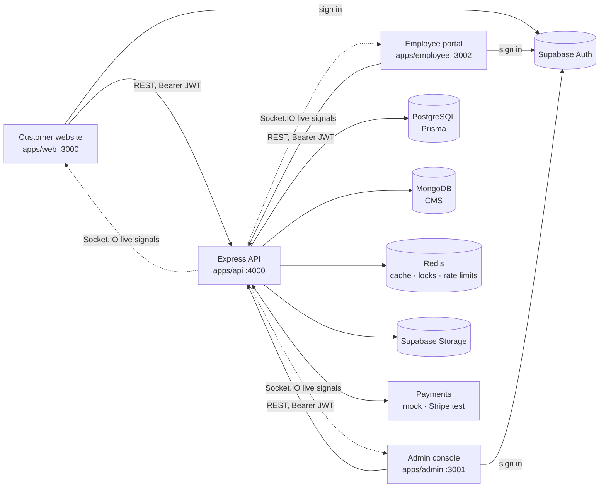
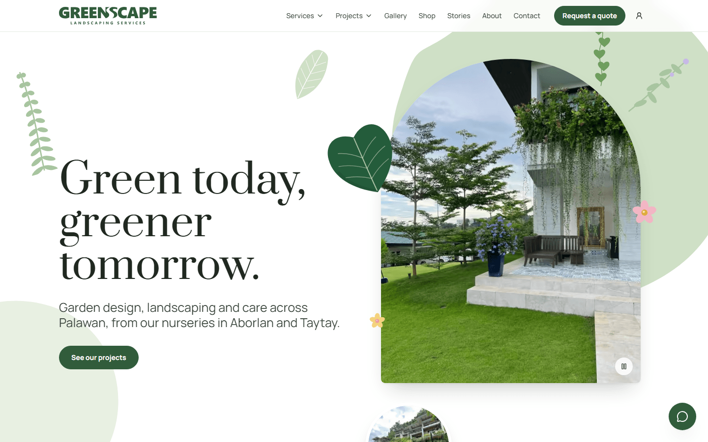
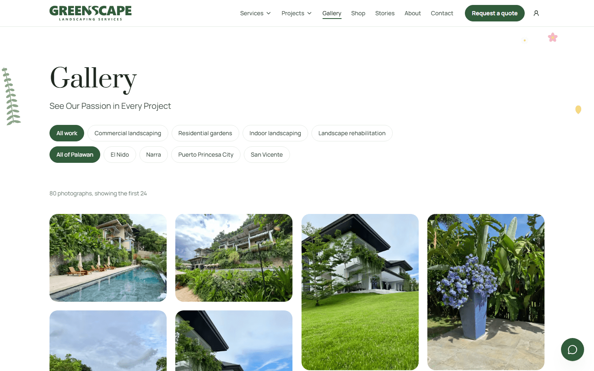
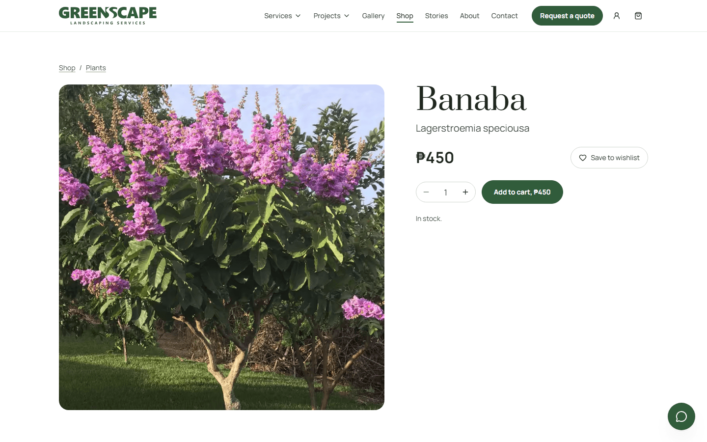
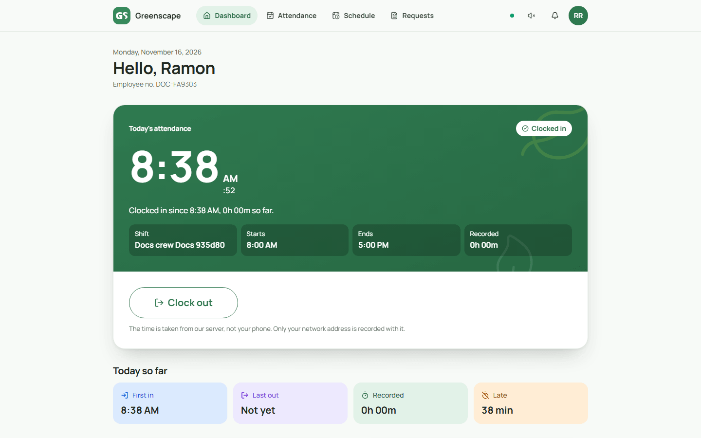
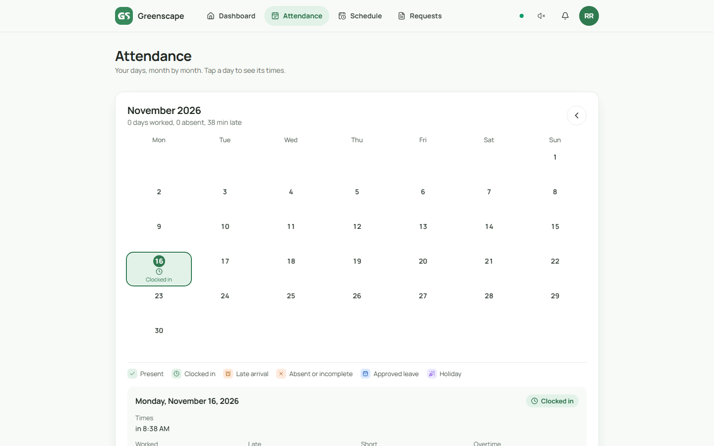
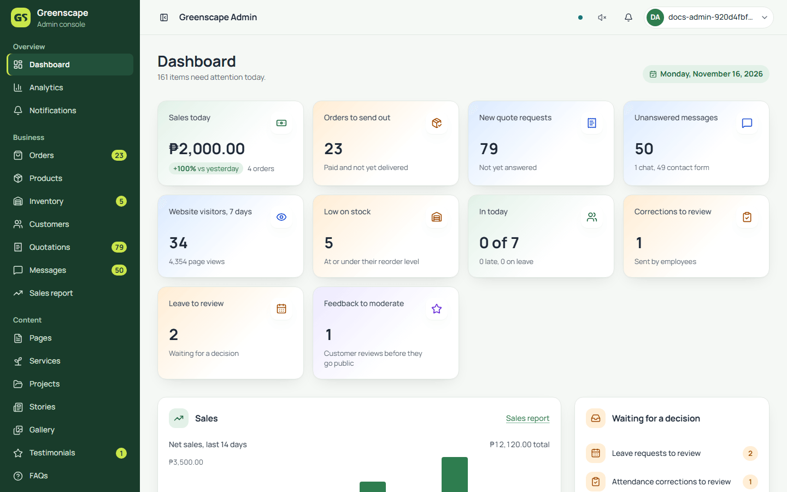
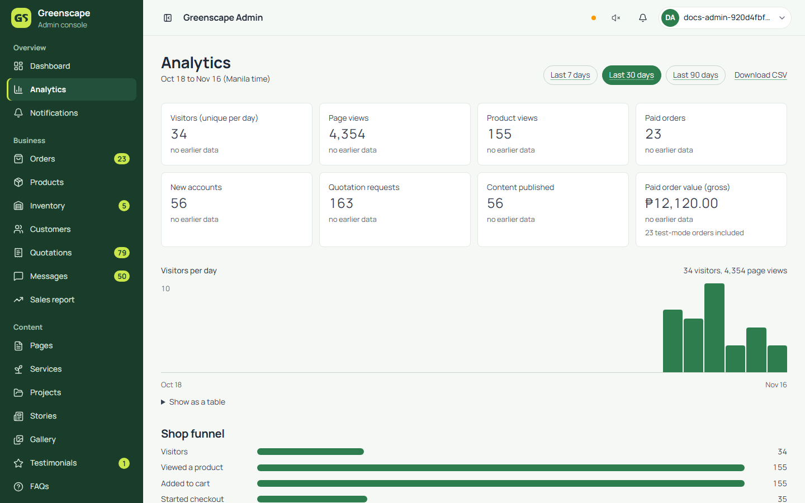
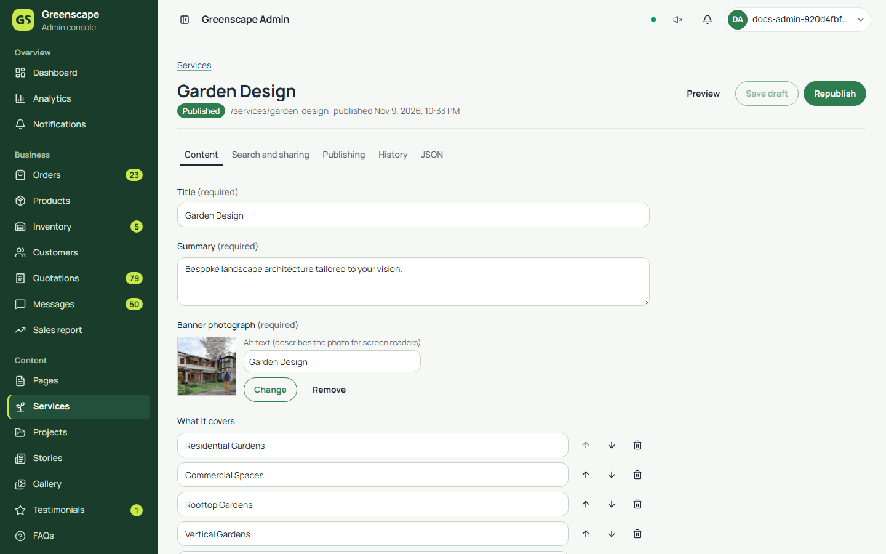

<p align="center">
  
</p>

<h1 align="center">Greenscape Landscaping PH</h1>

<p align="center">
  One platform for a Palawan landscaping business: a public website and plant shop, an employee attendance portal,
  and an admin console for content, orders and people.
</p>

<p align="center">
  
  
  
  
  
  
  
  
  
</p>

## Overview

Greenscape designs, builds and maintains gardens across Palawan and sells plants from its own nurseries. The
previous website (https://greenscapelandscapingph.com) was static pages reading a Firestore database straight from the
browser, with no cart and admin access checked only in the browser. This repository
rebuilds it as one system:

- **Customers** explore services and projects, buy plants online, request quotations and message the team.
- **Employees** clock in and out, see their schedule and attendance, and request leave or corrections.
- **Staff** manage website content, orders, stock, customers, employees, attendance and leave, with every action
  checked against their role on the server.

Payroll is out of scope by decision. What is finished, partial or not yet built is listed under
[Project status](#project-status).

## Architecture



Browsers never touch the databases: every read and write goes through the API, which verifies the Supabase token and
the user's permissions on each request. PostgreSQL holds transactions (orders, stock, people, attendance), MongoDB
holds the website content with drafts and revisions, Redis holds disposable cache and coordination. Thirteen more
diagrams: [docs/architecture/diagrams.md](docs/architecture/diagrams.md).

## The three portals

| Portal | App | Local | For | Sign-in |
|---|---|---|---|---|
| Customer website | `apps/web` | http://localhost:3000 | Visitors and customers | Email + password, or Google (per environment) |
| Employee portal | `apps/employee` | http://localhost:3002 | Field and nursery staff | Account created by HR, password changed on first sign-in |
| Admin console | `apps/admin` | http://localhost:3001 | Staff and administrators, by role | Email + password (optional TOTP) |
| API | `apps/api` | http://localhost:4000/v1/docs | The three apps | Bearer token |

## Screenshots

All screenshots are taken from the running local application by `pnpm docs:capture`, signed in as synthetic
accounts. Any real person's name, email or phone number in the local database is blanked out before each picture.

### Customer website



The homepage presents the four services, featured projects, a photo wall from the sites, stories and client reviews.
[Customer documentation](docs/customer/README.md)

| Gallery | Product page |
|---|---|
|  |  |
| Pinterest-style masonry with filters and a full-screen viewer. [More](docs/customer/services-projects-gallery.md) | Sizes, live stock, cart and test-mode checkout. [More](docs/customer/shop.md) |

### Employee portal

| Dashboard after clocking in | Attendance |
|---|---|
|  |  |
| One-tap clock card, upcoming shifts, last seven days. | Month calendar and each day's record. [Employee documentation](docs/employee/README.md) |

### Admin console



The dashboard shows each role only its own panels. [Admin documentation](docs/admin/README.md)

| Analytics | Content editor |
|---|---|
|  |  |
| Cookieless first-party analytics. | Drafts, preview, scheduled publishing, version history. |

## Features

**Customer website** — services with packages and before/after comparisons · project portfolio · masonry gallery
with lightbox · stories · testimonials with moderated reviews · FAQ · contact form · 3-step quotation request with
attachments · plant shop with search, filters, live stock · cart and checkout with stock holds (test payments) · order
pages · accounts with email verification, password reset, optional Google sign-in · profile, addresses, wishlist,
account deletion · two-way messages · AI assistant · notifications.

**Employee portal** — HR-provisioned login with forced first password change · one-tap clock in/out on server time
(optional selfie) · month calendar and day records (late, undertime, overtime) · schedule · leave requests checked
against balance · attendance corrections with attachments · notifications.

**Admin console** — role-aware dashboard · analytics · orders, refunds and fulfilment · products, sizes, prices ·
inventory with reasons and CSV stock counts · customers · quotations · message inboxes · sales report (CSV/Excel) ·
CMS for pages, services, projects, stories, gallery, testimonials, FAQs, site settings · employees and login
provisioning · work schedules · attendance board, corrections and leave approvals · attendance report · users,
built-in and custom roles · delivery areas · settings · system monitoring · audit log · AI assistant administration ·
notification centre with sounds and push.

**Across the system** — live updates over Socket.IO · Web Push · permission checks on every API route · audit log ·
CSP and security headers · rate limits · Redis cache with publish-time invalidation · one Docker image per app.

The full catalogue with pages, API routes and status: [docs/overview/feature-inventory.md](docs/overview/feature-inventory.md).

## Feature walkthroughs

| Workflow | Path through the system | Guide |
|---|---|---|
| Buy a plant | `/shop` → product → cart → `/checkout` → test payment → `/orders/[number]`; staff fulfil in `/orders` | [shop.md](docs/customer/shop.md), [commerce.md](docs/admin/commerce.md) |
| Request a quotation | `/quote` (3 steps, attachments) → reference number → `/quotations` in the admin → status in `/account` | [site-pages.md](docs/customer/site-pages.md), [commerce.md](docs/admin/commerce.md) |
| Onboard an employee | Admin `/employees/new` → Create login → employee signs in, sets a password | [hr.md](docs/admin/hr.md), [portal.md](docs/employee/portal.md) |
| A working day | Clock in → admin board updates live → day closes automatically → corrections and leave approved by HR | [portal.md](docs/employee/portal.md), [hr.md](docs/admin/hr.md) |
| Publish content | Edit draft → preview link → publish now or scheduled → cache invalidated → site updated | [cms.md](docs/admin/cms.md) |

## Video demonstration

**No demo video has been recorded or published yet.** The production package is ready: six presentations (full
walkthrough, short overview, promo, and one per portal), scene-by-scene storyboards, narration script, shot list and
a validated scene manifest. See [docs/video/README.md](docs/video/README.md) and the
[master storyboard](docs/video/master-storyboard.md). Links will be added here once videos are exported and reviewed.

## Technology stack

| Layer | Technology |
|---|---|
| Frontend | Next.js 16 (App Router), React 19, Tailwind CSS 4, shadcn/ui on Radix, Motion (portal widgets), CSS scroll-driven animation (public pages) |
| Backend | Express 5, TypeScript 5.9 run by `tsx`, Zod 4 contracts, OpenAPI 3.1 at `/v1/docs` |
| Data | PostgreSQL 17 via Prisma 7.10, MongoDB 8 for CMS, Redis 7 via ioredis |
| Identity and files | Supabase Auth (JWKS-verified JWTs, optional TOTP), Supabase Storage (public and private buckets, signed URLs) |
| Real time | Socket.IO 4 with the Redis adapter, Web Push (`web-push`, VAPID) |
| Payments | Provider interface: mock (local default) and Stripe test mode; live keys refused |
| AI | Assistant with Anthropic or OpenAI-compatible providers |
| Testing | Vitest 5 (unit, integration), Playwright 1.65 (e2e, visual, smoke), axe-core |
| Delivery | Docker (one image per app), Dokploy, GitHub Actions |

Verified against the code, with differences from the original brief: [system status](docs/overview/system-status.md#stack-discrepancies).

## Local development

Prerequisites: Node.js 22+ (24 used), pnpm 10, Docker, Supabase CLI.

```bash
pnpm install
```
```bash
cp .env.example .env
```
```bash
pnpm services:up
```
```bash
echo [] > supabase/signing_keys.json && supabase gen signing-key --algorithm ES256 --append
```
```bash
pnpm supabase:start
```
```bash
pnpm supabase:env
```
```bash
pnpm db:deploy
```
```bash
pnpm db:seed
```
```bash
pnpm content:indexes
```
```bash
pnpm content:seed
```
```bash
pnpm shop:seed
```
```bash
pnpm media:migrate --apply
```
```bash
pnpm storage:setup
```
```bash
pnpm dev
```

`services:up` starts PostgreSQL (:55433), MongoDB (:57017, replica set) and Redis (:56379) from
`docker/compose.dev.yml`. Then open the website (:3000), admin (:3001), employee portal (:3002) and API docs
(http://localhost:4000/v1/docs). Verification and reset emails land in the local inbox at http://127.0.0.1:54324.

Sample staff and employees: `pnpm staff:seed`. First administrator: sign in once, then

```bash
pnpm --filter @greenscape/database grant-role you@example.com super_admin
```

Optional per environment: Google sign-in (`NEXT_PUBLIC_AUTH_GOOGLE=true` plus a Google OAuth client in Supabase),
Web Push (`pnpm vapid:keys` → `VAPID_PUBLIC_KEY`, `VAPID_PRIVATE_KEY`), Stripe test keys (`PAYMENT_PROVIDER`), staff
MFA (`REQUIRE_STAFF_MFA`). All variables: [docs/deployment/environment-variables.md](docs/deployment/environment-variables.md).

## Deployment

Each app has its own Dockerfile built from the repository root; on Dokploy each is a separate application
(`<domain>`, `admin.<domain>`, `employee.<domain>`, `api.<domain>`) with PostgreSQL, MongoDB and Redis as internal
services and a one-off migration job. Pushes to `main` that pass **CI** and **Security** feed the production pipeline:
it builds a snapshot, smoke-tests it in a throwaway staging stack, publishes it to the `production` branch and asks
Dokploy to deploy. The Dokploy settings follow its documentation but have not yet been run against a live instance.

[Dokploy](docs/deployment/dokploy.md) · [CI/CD pipeline](docs/deployment/ci-cd-pipeline.md) ·
[production branch](docs/deployment/production-branch.md) · [rollback](docs/deployment/rollback.md) ·
[subdomains](docs/deployment/subdomains.md)

## Testing

| Command | What |
|---|---|
| `pnpm typecheck` | Every workspace and the tests |
| `pnpm lint` | ESLint (TypeScript, React hooks, Next.js, jsx-a11y) |
| `pnpm test` | Unit tests, no services needed |
| `pnpm test:integration` | API, auth and RBAC, cache, database constraints against Docker services and local Supabase |
| `pnpm build && pnpm test:e2e` | Playwright at 1440 desktop and 390 phone |
| `pnpm test:visual` | Visual regression baselines |
| `pnpm docs:capture` / `docs:validate` | Documentation screenshots / documentation checks |

Last recorded full runs (2026-11-12): unit 110, integration 181, e2e 216 passed on CI. Details:
[docs/testing.md](docs/testing.md).

## Documentation

| Area | Start at |
|---|---|
| Everything | [docs/README.md](docs/README.md) |
| Status and coverage | [System status](docs/overview/system-status.md) · [Route coverage](docs/overview/route-coverage.md) · [Feature inventory](docs/overview/feature-inventory.md) |
| Portals | [Customer](docs/customer/README.md) · [Employee](docs/employee/README.md) · [Admin](docs/admin/README.md) |
| Architecture | [Diagrams](docs/architecture/diagrams.md) · [Architecture](docs/architecture.md) · [Database](docs/database-schema.md) · [API](docs/api-documentation.md) · [Realtime](docs/realtime/README.md) · [Notifications](docs/notifications.md) |
| Security | [docs/security.md](docs/security.md) |
| Operations | [Deployment](docs/deployment.md) · [Testing](docs/testing.md) · [Progress log](docs/progress.md) |
| Video | [docs/video/README.md](docs/video/README.md) |

## Docs
`docs/audit/` (what exists today) · `docs/architecture.md` · `docs/database-schema.md` · `docs/implementation-plan.md` · `docs/migration-plan.md` · `docs/ui-ux-guidelines.md` · `docs/animation-system.md` · `docs/security.md` · `docs/api-documentation.md` · `docs/testing.md` · `docs/progress.md` · `docs/pwa/` (installable Admin and Employee apps) · `docs/branding/` (logo and app icons)

```bash
cd scripts/audit && node crawl.mjs 80 && node lighthouse.mjs && node report.mjs
```

## Project status

| | |
|---|---|
| **Implemented and verified** | Customer website, shop with test payments, accounts, quotations, messages; employee portal with attendance, schedule, leave and corrections; full admin console; real-time updates; audit log; CI/CD pipeline |
| **Implemented, needs per-environment setup** | Google sign-in (OAuth client), Web Push (VAPID keys), Stripe test mode (keys), staff MFA (flag), AI assistant (provider key) |
| **Partial** | Offline: a banner only, no offline data. Dokploy deployment: configured, not yet run on a live instance |
| **Not on `main` yet** | Installable PWA (web app manifests are on unmerged branches) |
| **Not built by decision** | Real payment provider for the Philippines (interface ready), payroll |
| **Known limitations** | Lighthouse performance below 90 on home, project list and shop; products show "Price on request" until staff set prices; no private data migrated from the old site |

Details: [docs/overview/system-status.md](docs/overview/system-status.md) and [docs/progress.md](docs/progress.md).

## License

No license file is included in this repository.
