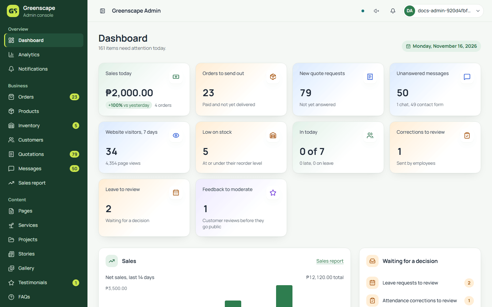

# Admin console

`apps/admin` · local http://localhost:3001 · production `admin.<domain>`

The staff workspace for running Greenscape: sales and orders, the product catalogue and stock, customers,
quotations and messages, website content, employees, attendance and leave, users and roles, settings and system
health. What each person sees is decided by their permissions, checked by the API on every request.

## Pages

| Guide | Sidebar group | Routes |
|---|---|---|
| [Sign-in, dashboard, analytics, notifications](console.md) | Overview | `/login`, `/mfa`, `/password`, `/`, `/analytics`, `/notifications` |
| [Commerce](commerce.md) | Business | `/orders`, `/products`, `/inventory`, `/customers`, `/quotations`, `/messages`, `/reports/sales`, `/settings/delivery` |
| [CMS](cms.md) | Content | `/cms`, `/cms/[type]`, `/cms/[type]/new`, `/cms/[type]/[slug]`, `/cms/gallery`, `/cms/testimonials`, `/cms/faqs`, `/cms/site` |
| [HR and attendance](hr.md) | Workforce | `/employees`, `/employees/new`, `/employees/[id]`, `/employees/schedules`, `/attendance`, `/attendance/employee/[id]`, `/attendance/corrections`, `/leave`, `/leave/balances`, `/leave/settings`, `/reports/attendance` |
| [Users, roles and system](system.md) | Administration | `/users`, `/users/roles`, `/users/roles/[key]`, `/system`, `/settings`, `/audit`, `/assistant`, `/assistant/knowledge`, `/assistant/conversations`, `/assistant/conversations/[id]` |

## Shell

- **Sidebar** with five groups (Overview, Business, Content, Workforce, Administration). Items are filtered by
  permission (`apps/admin/lib/nav.ts`): a menu entry exists only when the person may open it. Badges show work
  waiting (orders to send, low stock, new quotations, unread messages, testimonials to moderate, corrections, leave).
- **Header**: notification bell with unread count and dropdown, sound toggle, live-connection status, account menu
  (name, roles, sign out).
- **Live refresh**: pages subscribe to Socket.IO topics (`apps/admin/lib/live-topics.ts`) and re-fetch when something
  they show changes ([realtime](../realtime/README.md)).
- **States**: skeleton loading, botanical empty states, an error page with retry, a 404 inside the shell, and an
  offline banner.
- On phones the sidebar becomes a drawer.

## Roles

Eight built-in roles plus custom roles created at `/users/roles`. Built-in: `super_admin` (everything), `admin`
(everything except managing super admins and secret settings), `content_manager`, `ecommerce_manager`,
`inventory_staff`, `hr_manager`, `employee`, `customer`. Full matrix:
[security/authorization-matrix.md](../security/authorization-matrix.md), [auth/role-permissions.md](../auth/role-permissions.md).

All screenshots in these guides were taken as a synthetic **super admin**, so every menu entry and dashboard panel is
visible. Other roles see a subset.

Source: `apps/admin/app/(console)/`, `apps/admin/components/`, `apps/admin/lib/`. Tests: `tests/e2e/admin.spec.ts`,
`permissions.spec.ts`, `cms.spec.ts`, `attendance.spec.ts`, `system.spec.ts`, `analytics.spec.ts`, `assistant.spec.ts`,
`tests/e2e/admin/`.
