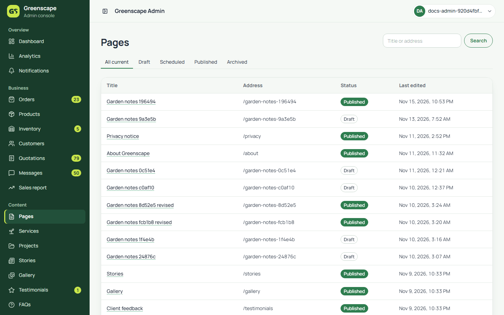
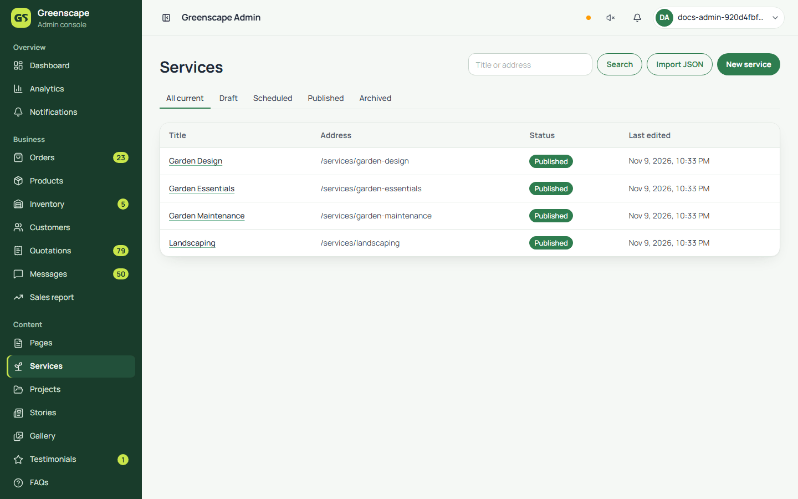
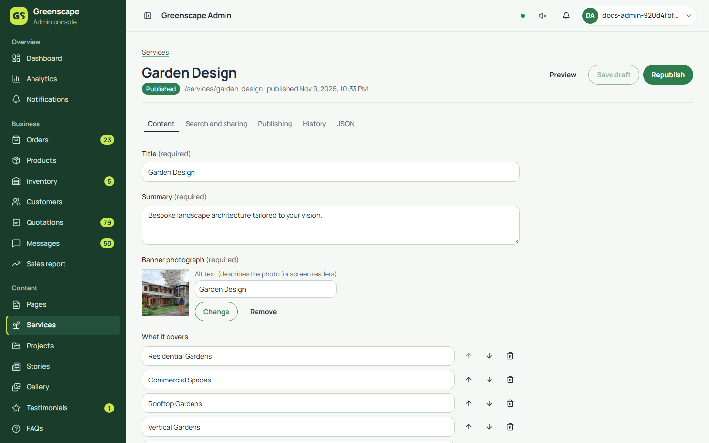
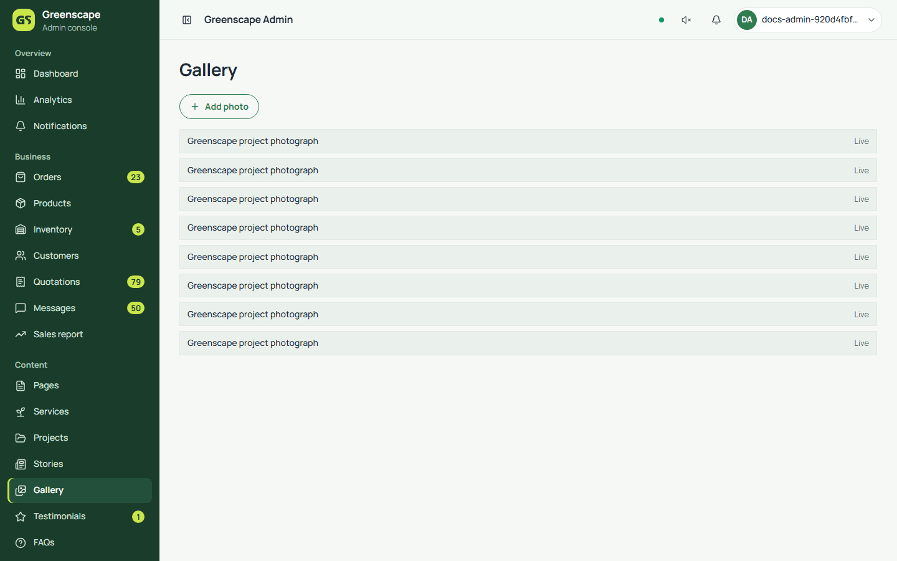
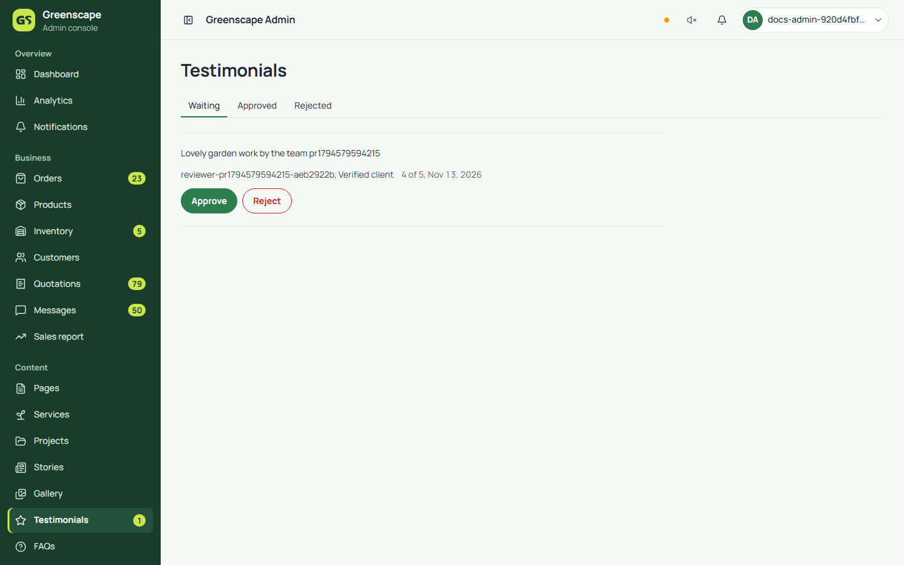
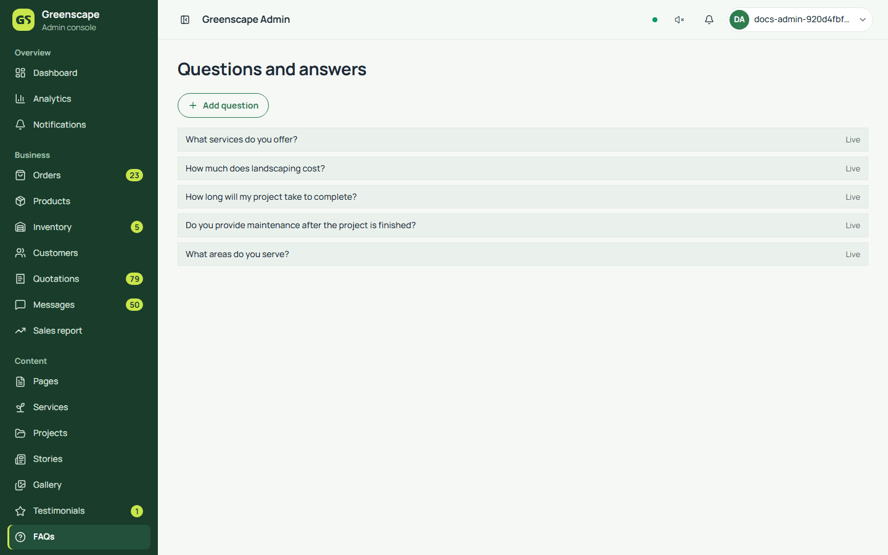
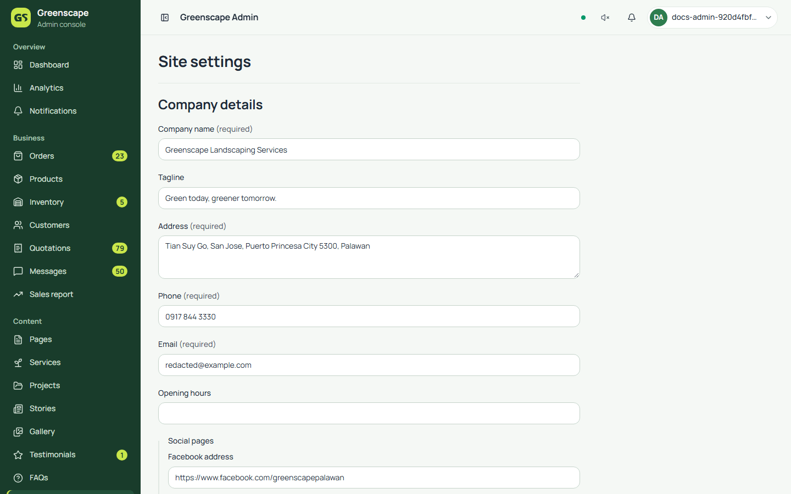

# Content management (CMS)

The Content group of the admin console: everything the public website says and shows. Content is stored as MongoDB
documents with a draft/published envelope and a revision history; publishing invalidates the Redis cache and
revalidates the website pages. Diagram: [CMS publishing and cache invalidation](../architecture/diagrams.md#6-cms-publishing-and-cache-invalidation).
Earlier write-up: [cms-management.md](cms-management.md).

**Permissions** `cms.read` to view, `cms.write` to edit, `cms.publish` to publish; `testimonials.moderate` for reviews;
`media.read` / `media.write` for the media library. Built-in role: `content_manager`.

---

## Overview and collections

**URLs** `/cms`, `/cms/[type]` (`pages`, `services`, `projects`, `articles`) · **Source** `apps/admin/app/(console)/cms/`,
`components/collection-manager.tsx`

| CMS home | Services collection |
|---|---|
|  |  |

Pages: [pages-desktop.png](../assets/screenshots/admin/cms/pages-desktop.png) · projects:
[projects-desktop.png](../assets/screenshots/admin/cms/projects-desktop.png) · stories:
[articles-desktop.png](../assets/screenshots/admin/cms/articles-desktop.png)

Each collection lists its documents with status filters (draft, scheduled, published, archived), last change and
author; **New** starts from a template; JSON export and import.

---

## Document editor

**URLs** `/cms/[type]/[slug]`, `/cms/[type]/new` · **Source** `apps/admin/components/content-editor.tsx`, `fields.tsx`, `rich-text-editor.tsx`,
`new-doc-form.tsx`, `media.tsx`

New document: [service-new-desktop.png](../assets/screenshots/admin/cms/service-new-desktop.png)

| Tab | What |
|---|---|
| Content | Fields generated from the document's Zod schema: text, rich text (Tiptap, limited to what the site renders), image picker with upload, repeatable groups, and for pages a section builder with reordering |
| Search and sharing | Title, description, social image |
| Publishing | Publish now, schedule a time, unpublish, archive, export; a signed **Preview** link (10 minutes, path-bound) opens the draft on the real website in draft mode |
| History | Every save, publish and rollback as a revision; restore any of them |
| JSON | The raw document |

### Workflow
1. Edit and **Save**: a draft; concurrent edits are caught by an optimistic revision check.
2. **Preview** on the website.
3. **Publish** (or schedule: a 60-second, Redis-locked worker publishes due documents, so several API instances never
   double-publish).
4. The API copies draft → published in one conditional update, records the revision, deletes the tagged Redis keys
   and calls the website's `/api/revalidate`. The live page changes on the next request.

### Video notes
Scene `full-11`: edit one sentence of a sample service, save, preview side by side. Do not publish on a shared
environment.

---

## Gallery

**URL** `/cms/gallery` · **Source** `apps/admin/app/(console)/cms/gallery/`

Gallery items for `/gallery`: photograph (from the media library), caption, category, order (lower first) and
visibility. Images keep their stored dimensions, which the masonry layout uses.

---

## Testimonials

**URL** `/cms/testimonials` · **Permission** `testimonials.moderate` · **Source** `components/moderate-buttons.tsx`

Reviews submitted on the website wait here (sidebar badge, notification). **Approve** ("It now appears on the
site"), **Reject**, or move back to waiting.

---

## FAQs and site settings

**URLs** `/cms/faqs`, `/cms/site` · **Source** `components/site-settings.tsx`

| FAQs | Site settings |
|---|---|
|  |  |

FAQs: question, answer, topic (groups questions), order and visibility. Site settings: company name and contact details, social links, header and footer
menus.

---

## Media library

Used from every image field: uploads go straight to Supabase Storage through a signed URL the API issued; the API then
checks magic bytes, decodes the image, stores dimensions and a blur placeholder, and requires alt text. An image still
used by content cannot be deleted; `pnpm media:sweep` removes unused ones.
[storage-security.md](../security/storage-security.md).
