# Commerce: orders, products, inventory, customers, quotations, messages

The Business group of the admin console. Customer side of the same flows: [shop](../customer/shop.md),
[quote request](../customer/site-pages.md#quotation-request), [account and messages](../customer/account.md).
Screenshots taken as a synthetic super admin; the records are seed and test data.

---

## Orders

**URLs** `/orders`, `/orders/[id]` · **Permission** `orders.read`; actions need `orders.fulfill`, `orders.manage`,
`payments.refund` · **Source** `apps/admin/app/(console)/orders/`, `components/order-actions.tsx`; API `/v1/shop-admin/orders`

| List | Order |
|---|---|
| 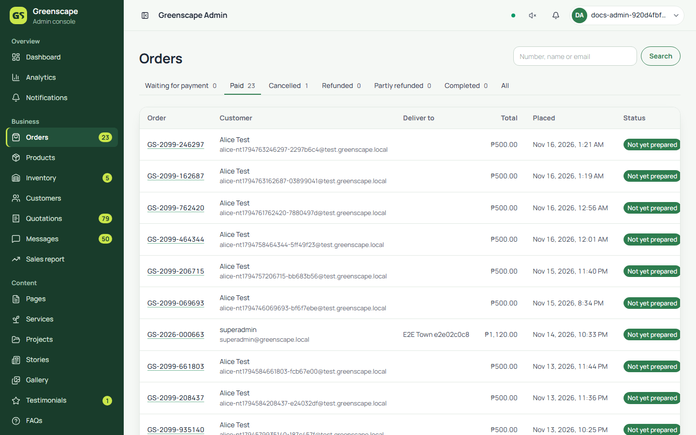 | 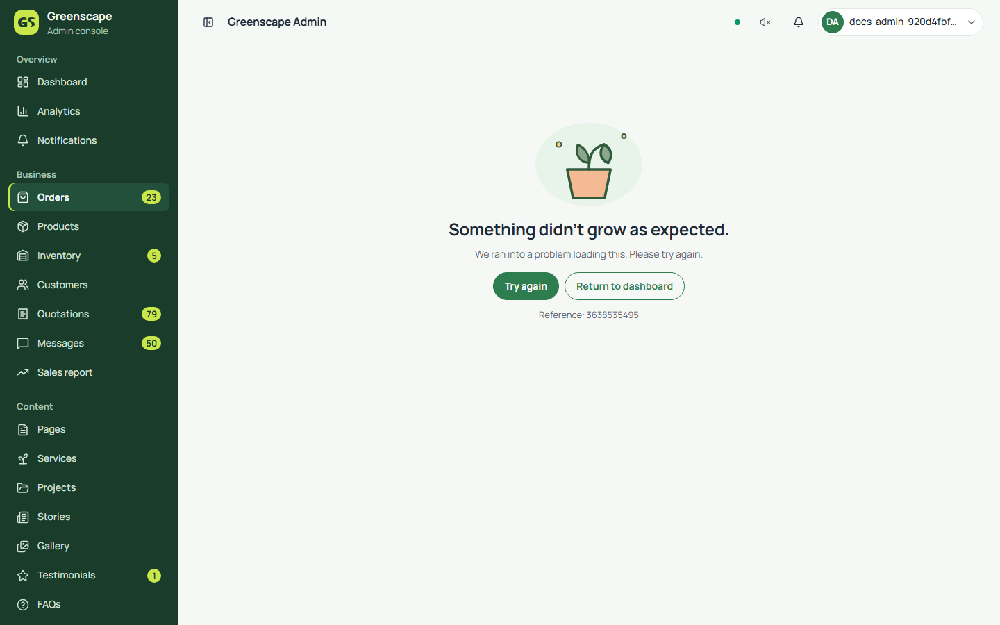 |

### Features
| Feature | Behaviour | Status |
|---|---|---|
| Status tabs | Waiting for payment, Paid, Completed, Cancelled, Refunded, Partly refunded, All, each with a count; sidebar badge for orders to send | Implemented and verified |
| Order detail | Customer, items, delivery address and area, payment (test or live), event history | Implemented and verified |
| Fulfilment | Not yet prepared → being prepared → out for delivery → delivered (or returned); the customer is emailed when it is out for delivery and when delivered | Implemented and verified |
| Cancel | Releases held stock | Implemented and verified |
| Refund | Partial or full through the payment provider, optional restock, recorded and emailed | Implemented and verified |

Every change is written to the audit log. Real-time: new and paid orders refresh the list. Empty state: "No orders
here".

---

## Products

**URLs** `/products`, `/products/new`, `/products/[id]` · **Permission** `products.read`, `products.write` · **Source**
`apps/admin/app/(console)/products/`, `components/product-editor.tsx`, `variants-editor.tsx`

| List | Editor |
|---|---|
| 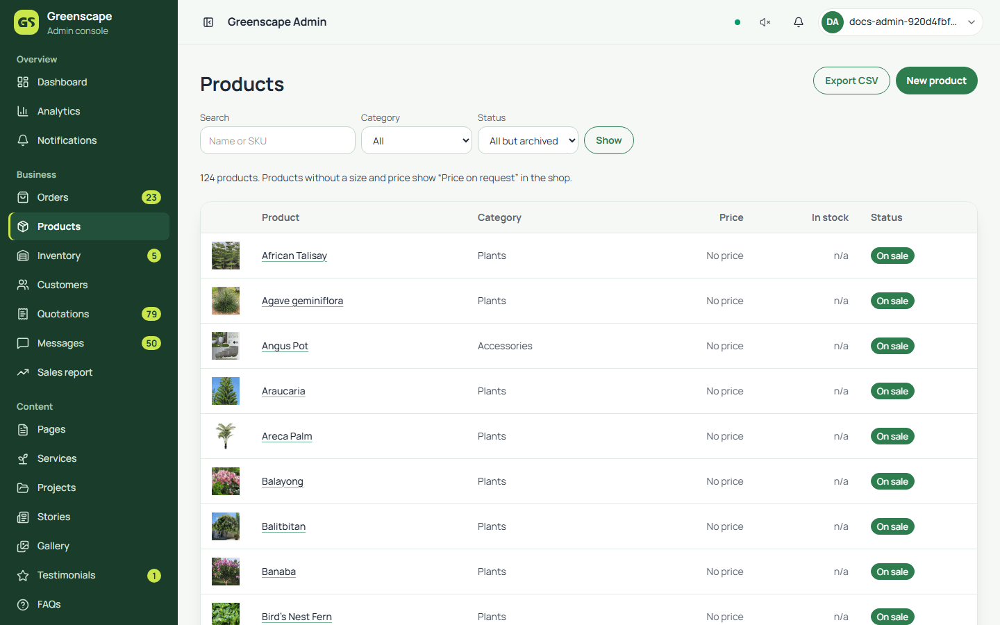 | 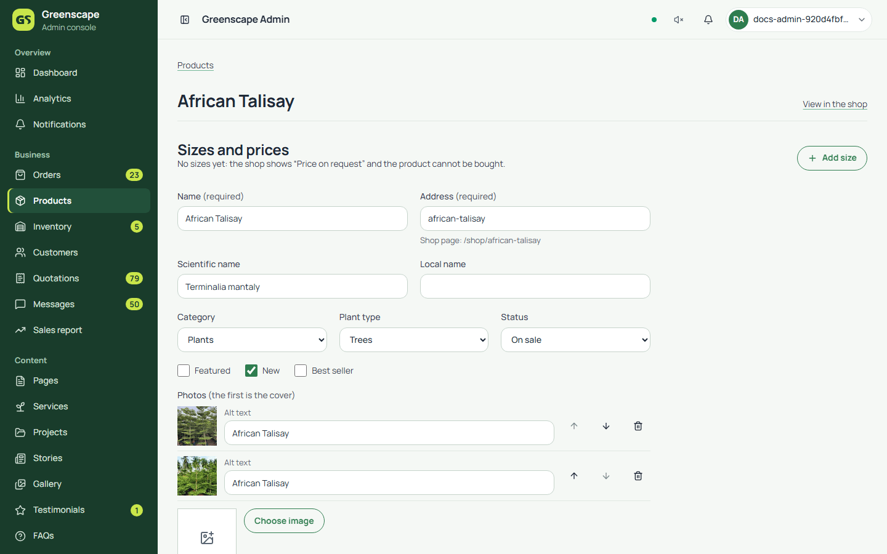 |

New product: [product-new-desktop.png](../assets/screenshots/admin/products/product-new-desktop.png)

- Search and filter the catalogue; CSV export.
- Editor: name, scientific and local names, category, plant type, status (draft, active, hidden, archived), flags
  (featured, new, best seller), photos from the media library, sizes with SKU, price and compare-at price. Price and
  size changes are audited.
- Marketing and care text lives in MongoDB with the product; the transactional parts (price, stock) in PostgreSQL.
- Saving invalidates the catalogue cache and revalidates the shop pages.

---

## Inventory

**URL** `/inventory` · **Permission** `inventory.read`, `inventory.adjust` · **Source** `apps/admin/app/(console)/inventory/`,
`components/inventory.tsx`, `import-button.tsx`

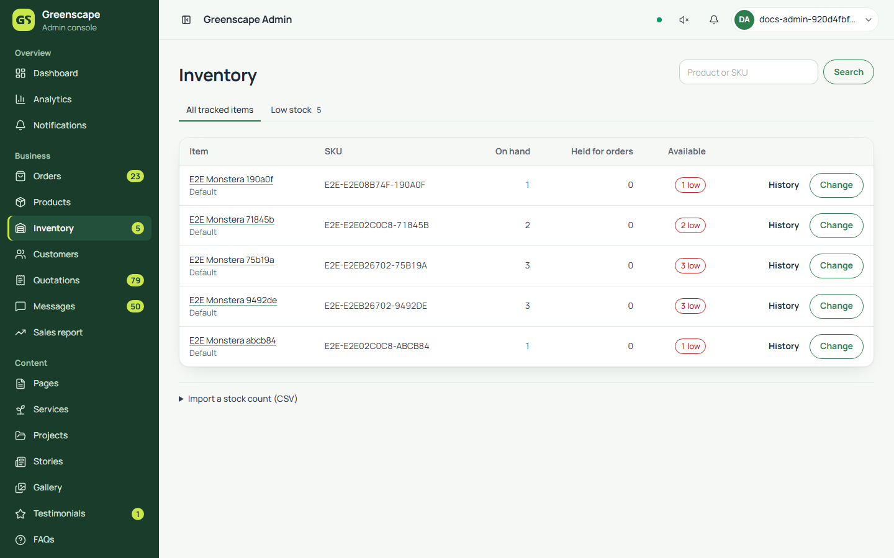

- On hand, reserved (held by unpaid orders) and available per size; low-stock threshold and a sidebar badge.
- **Adjust** with a reason: every change is a `StockMovement` (received, adjusted, sale, reserved, released, returned, damaged), so history can be traced.
- **CSV stock count import** with a preview of changes before applying.
- Low stock notifies the people set in [Settings](system.md#settings).

---

## Customers

**URLs** `/customers`, `/customers/[id]` · **Permission** `customers.read` · **Source** `apps/admin/app/(console)/customers/`

| List | Customer |
|---|---|
| 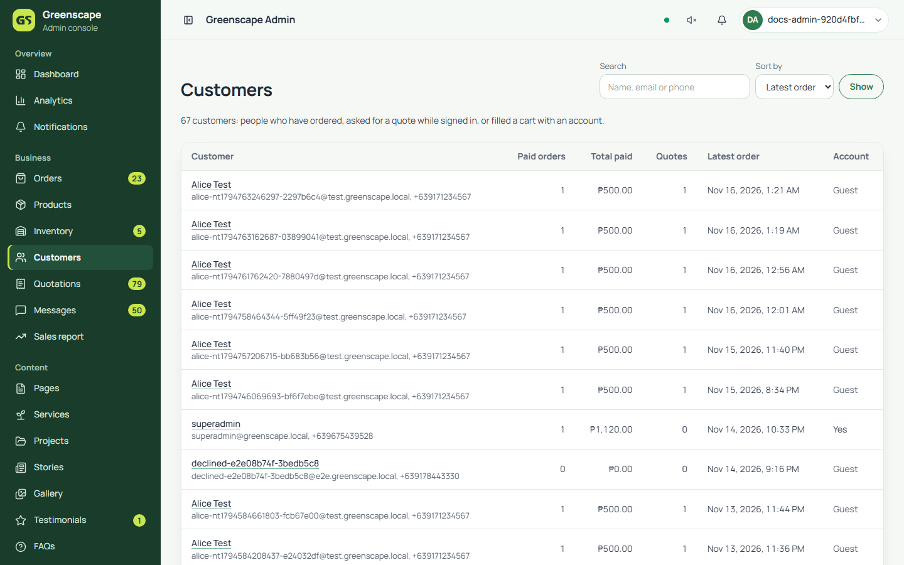 | 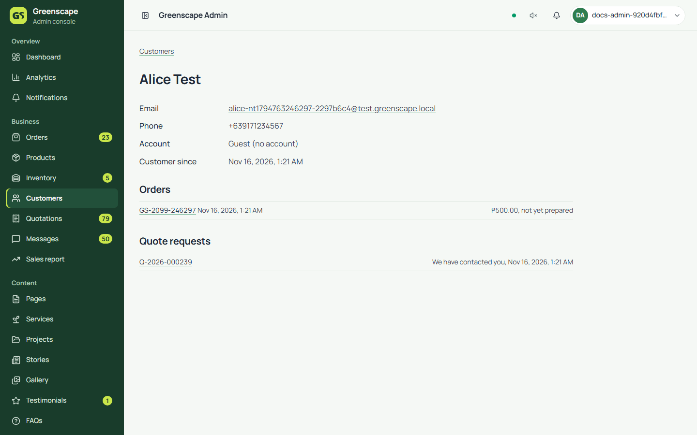 |

Search and sort; paid-order totals, order and quotation counts; detail with orders, quotations and messages.
Read-only: customers manage their own details.

---

## Quotations

**URLs** `/quotations`, `/quotations/[id]` · **Permission** `quotations.read`, `quotations.manage` · **Source**
`apps/admin/app/(console)/quotations/`; API `/v1/quotations`

| Queue | Quotation |
|---|---|
| 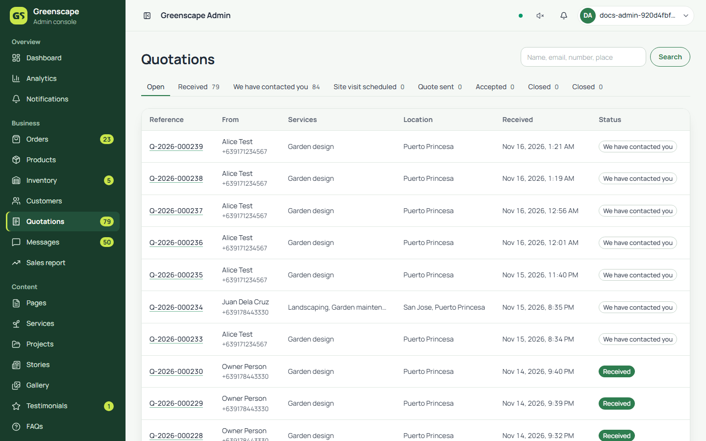 | 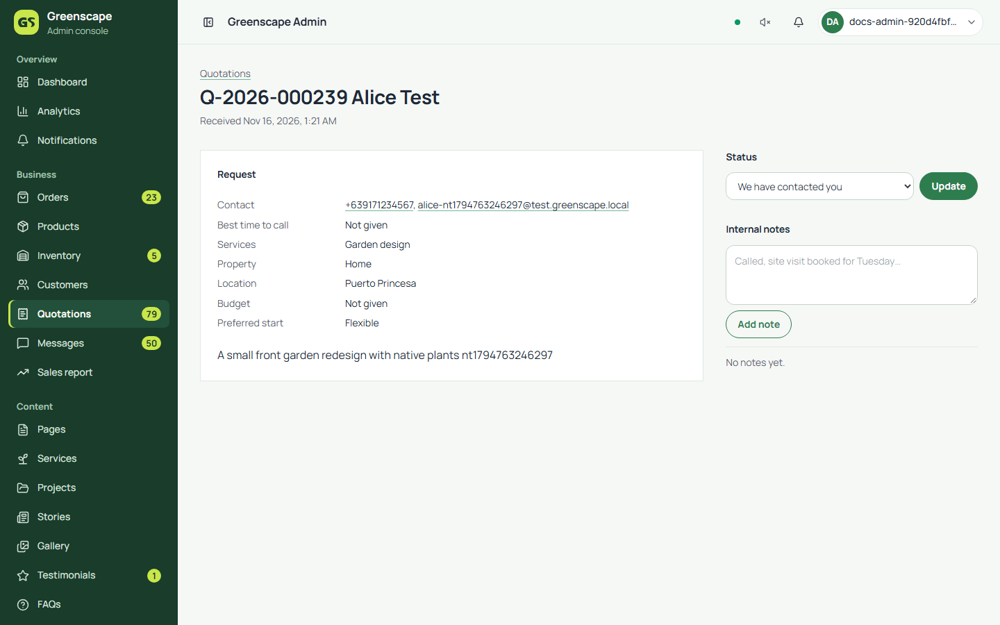 |

Queue by status (new, contacted, site visit, quoted, won, lost, archived) with a badge for new requests. Detail: reference number,
services, property and location, budget and dates, the request text, attachments (opened through short-lived signed
URLs from private storage), internal notes and status changes. The customer sees the status in their account.

---

## Messages

**URLs** `/messages`, `/messages/[id]`, `/messages/contact` · **Permission** `messages.read`, `messages.reply` ·
**Source** `apps/admin/app/(console)/messages/`, `components/thread-reply.tsx`

| Customer chats | Contact form inbox |
|---|---|
| 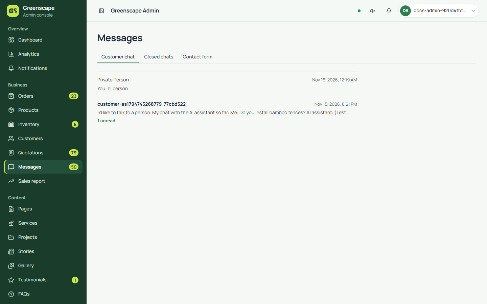 | 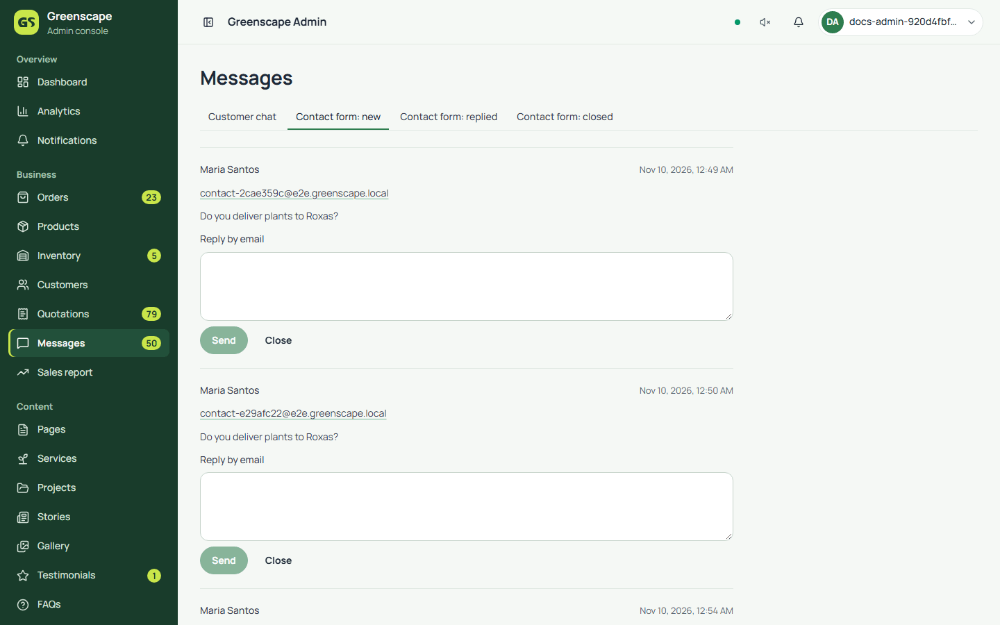 |

Thread: [message-thread-desktop.png](../assets/screenshots/admin/messages/message-thread-desktop.png)

- **Customer chats**: two-way threads with signed-in customers (the website's `/messages`), unread counts; replies
  appear in the customer's thread and are emailed.
- **Contact form**: inquiries from `/contact` with new / replied / closed; reply by email from the console.

---

## Sales report

**URL** `/reports/sales` · **Permission** `reports.sales` · **Source** `apps/admin/app/(console)/reports/sales/`

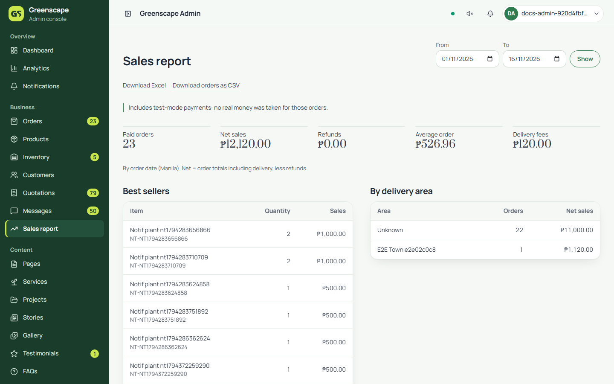

Gross sales, refunds, net, average order, delivery fees, best sellers and sales by delivery area for a chosen period;
CSV and Excel downloads.

---

## Delivery areas

**URL** `/settings/delivery` · **Permission** `settings.read`, `settings.manage` · **Source** `apps/admin/app/(console)/settings/delivery/`, `components/zones-editor.tsx`

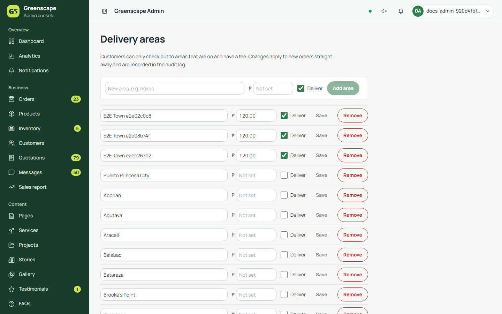

Municipalities with their delivery fee, active flag and order. Only active areas appear at checkout. The Palawan
municipalities are seeded **inactive with no fee** for the business to set (decision D7).

---

## Video notes
Scene `full-12`: Orders (filter, open an order, fulfilment steps) → Products → Inventory (adjust with a reason) → then
the HR pages. Use test orders only.
