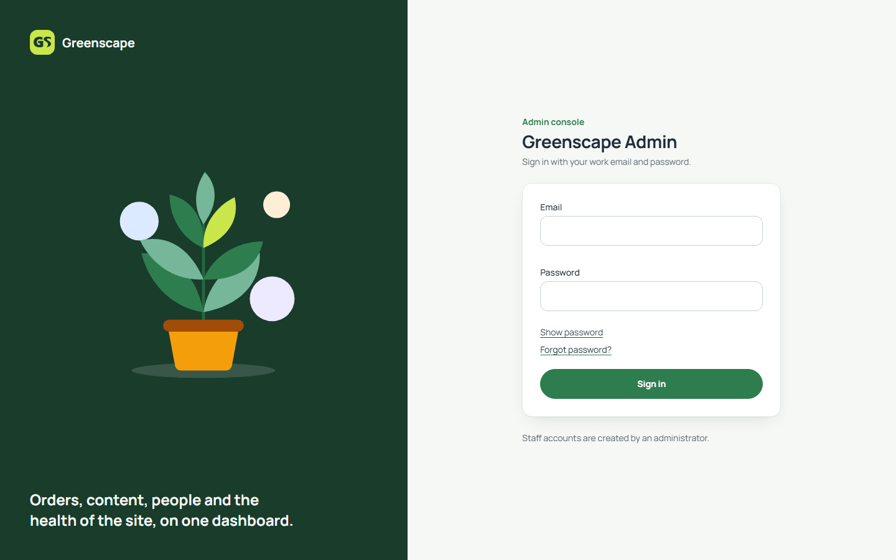
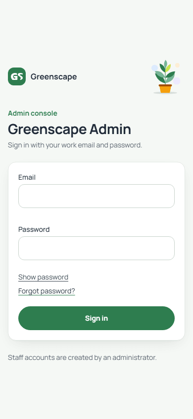
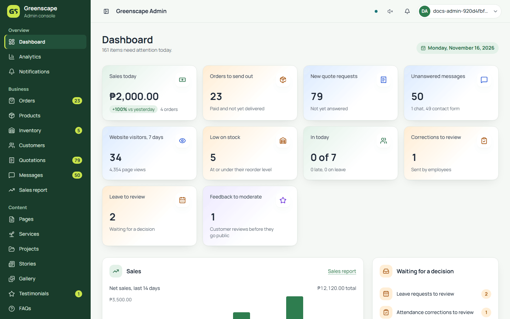
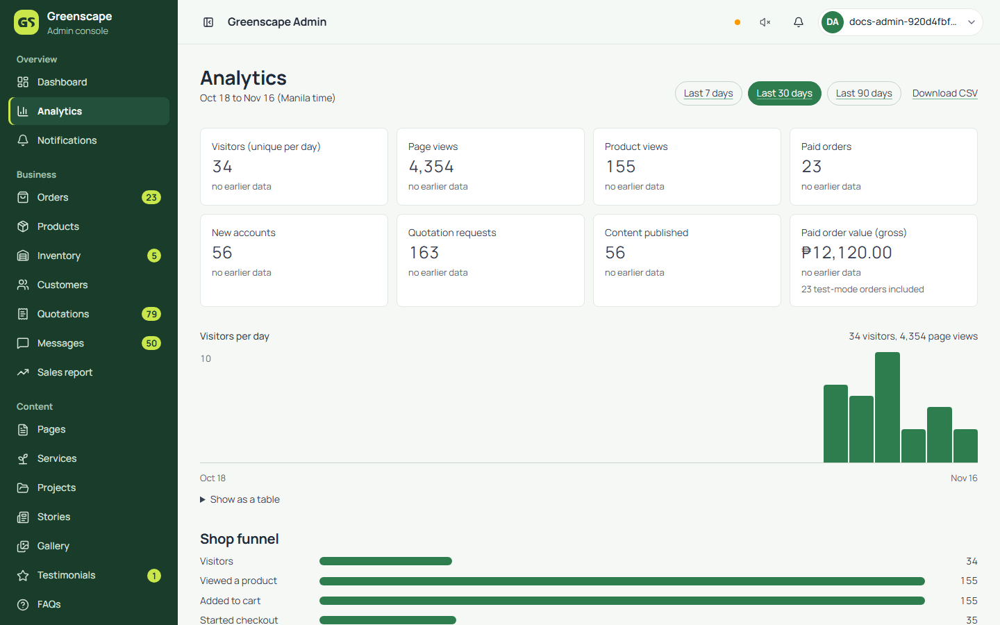
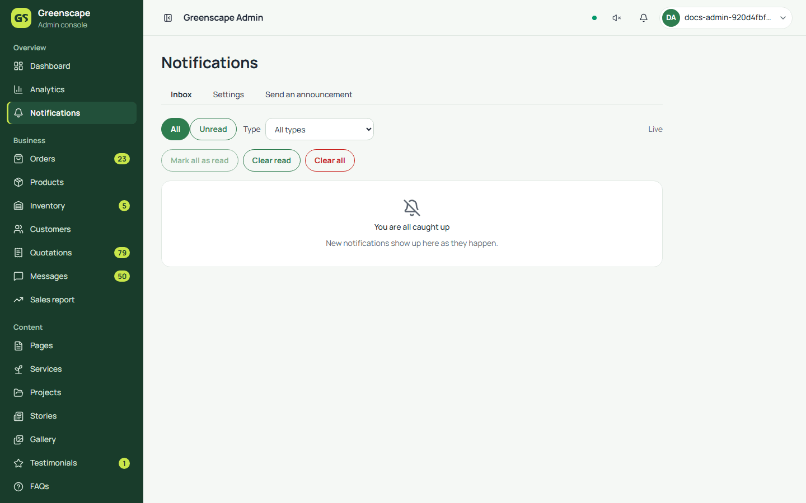
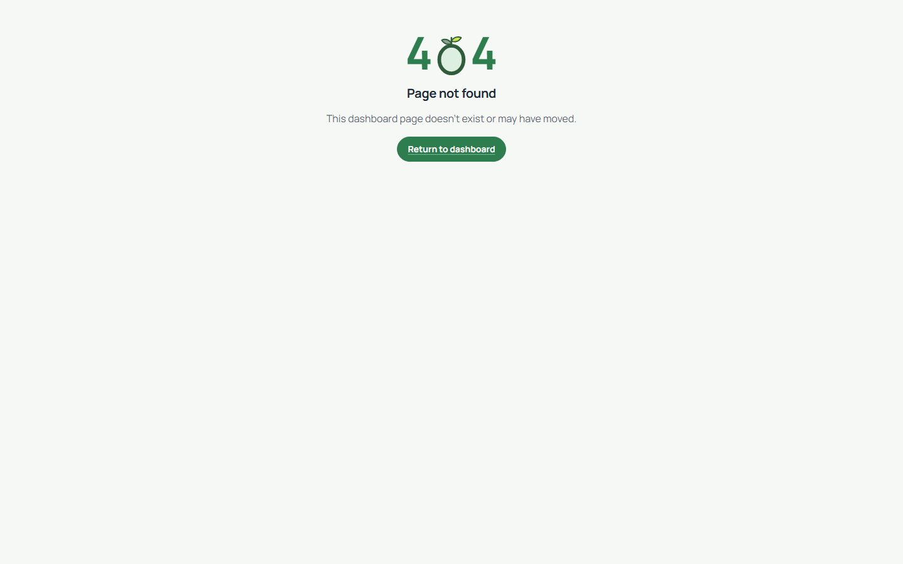

# Sign-in, dashboard, analytics and notifications

The admin console's entry points (Overview group). Shell, roles and permissions: [admin README](README.md).
Screenshots taken as a synthetic super admin at 1440 × 900 and 390 × 844.

---

## Sign in, MFA, password

**URLs** `/login`, `/mfa`, `/password` · **Access** public (sign-in), signed-in staff (MFA, password) · **Source**
`apps/admin/app/login/`, `mfa/`, `password/`, `apps/admin/components/mfa-form.tsx`

"Greenscape Admin": email and password only, no Google button and no registration (administrators create staff
accounts at [Users](system.md#users)).

| Desktop | Phone |
|---|---|
|  |  |

| Step | When | Behaviour |
|---|---|---|
| `/mfa` "Confirm it’s you" | `REQUIRE_STAFF_MFA=true` (off by default) | Enrol an authenticator (QR code and a key for manual entry) or enter the current 6-digit code; the session becomes `aal2` |
| `/password` | A temporary password from an administrator | Choose a new password before anything else opens |
| No access notice | A signed-in person without staff permissions, or any Google session | Explains the console is for staff; nothing else loads |

Diagram: [admin authentication and authorization](../architecture/diagrams.md#4-admin-authentication-and-authorization).
Status: implemented and verified (`tests/e2e/auth/admin-login.spec.ts`, `superadmin-login.spec.ts`, `mfa.spec.ts`).

---

## Dashboard

**URL** `/` · **Access** `admin.access`; each panel needs its own permission · **Source** `apps/admin/app/(console)/page.tsx`,
`apps/admin/lib/overview.ts`; API `GET /v1/admin/overview`

### Overview
"Good day, {first name}" (or "Dashboard" when the account has no name, as in the screenshot) and a count of items
that need attention today. One permission-aware endpoint returns only the sections the person may see, so a content
manager, an HR manager and a sales manager each get a different dashboard.

Phone: [dashboard-mobile.png](../assets/screenshots/admin/dashboard/dashboard-mobile.png)

### Panels
| Panel | Shows | Links to | Permission |
|---|---|---|---|
| Key figures | Cards: sales today (vs yesterday), orders to send out, new quote requests, unanswered messages (chat and contact form), website visitors (7 days), low on stock, in today, corrections to review, leave to review, feedback to moderate | each queue | per card |
| Sales | Sales today and a 14-day net-sales bar chart (hover/focus tooltips, table view, test-payment notice) | Sales report | `reports.sales` |
| Waiting for a decision | Orders to send, new quotes, unanswered messages, feedback to moderate, corrections, leave; "All caught up" when empty | each queue | per queue |
| Website traffic | Visitors per day, last 7 days | Analytics | `analytics.read` |
| Attendance today | Who is in, late, absent; "No active employees yet" when none | Attendance | `attendance.read` |
| Latest orders / Latest quote requests | Five most recent | Orders / Quotations | `orders.read` / `quotations.read` |
| Recent content changes | Latest CMS saves and publishes | CMS | `cms.read` |
| System status | Database, MongoDB, Redis, storage health | System | `system.monitor` |

Real-time: panels refresh when orders, quotations, messages or attendance change. Permission matrix test:
`permissions.spec.ts` checks dashboard tiles against each of the 8 roles.

### Video notes
Scene `full-10`, `overview-05`: highlight each panel in turn, then open the sidebar groups.

---

## Analytics

**URL** `/analytics` · **Access** `analytics.read` (admin, content, e-commerce) · **Source** `apps/admin/app/(console)/analytics/page.tsx`;
API `/v1/admin/analytics`

Cookieless, first-party analytics: the website sends a beacon to its own `/api/collect` (dropped when the browser
sends Do Not Track or Global Privacy Control), the API counts it into daily rows, and unique visitors are estimated
with a Redis HyperLogLog of a daily-keyed hash. Nothing personal is stored.

| Section | Content |
|---|---|
| Period | Choose the range; every figure compares with the previous period |
| Headline figures | Visitors, page views, product views, paid orders and value (with `reports.sales`), new accounts, quotations, content published |
| Visitors per day | Bar chart with table view |
| Shop funnel | Visitors → viewed a product → added to cart → started checkout → paid orders |
| Most visited pages, Traffic sources, Most viewed products, Most viewed services, Devices, Countries | Ranked lists |
| Download CSV | The selected period |

Status: implemented and verified (`analytics.spec.ts`). Local data is synthetic and sparse.

---

## Notifications

**URL** `/notifications` · **Access** `admin.access` · **Source** `apps/admin/app/(console)/notifications/page.tsx`,
`packages/ui/src/notifications/center.tsx`, `apps/admin/components/notifications-form.tsx`

The full notification centre: list with category icons and priority markers, unread state, mark all read, clear
read / clear all; per-category preferences for in-app alerts, push and sound; push on this device (`PushToggle`);
sound settings. The header bell shows the unread count and the latest items. Who receives what is decided by
permission in `apps/api/src/modules/notifications/handlers.ts` ([notifications.md](../notifications.md),
[sound-effects.md](../notifications/sound-effects.md)).

---

## Not found and errors

A 404 inside the console shell, and an error page with **Try again** (`apps/admin/app/(console)/error.tsx`).
