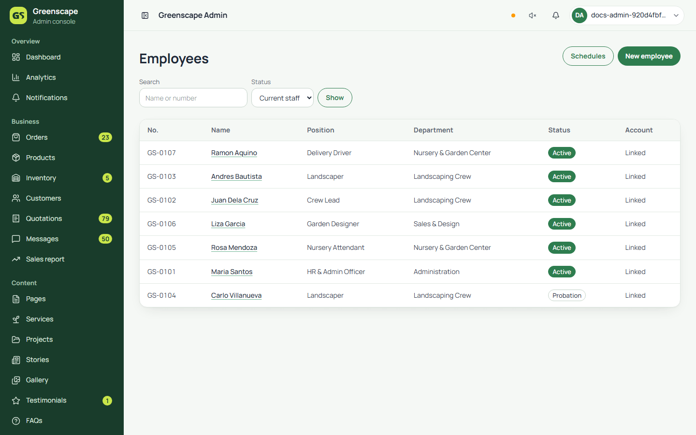
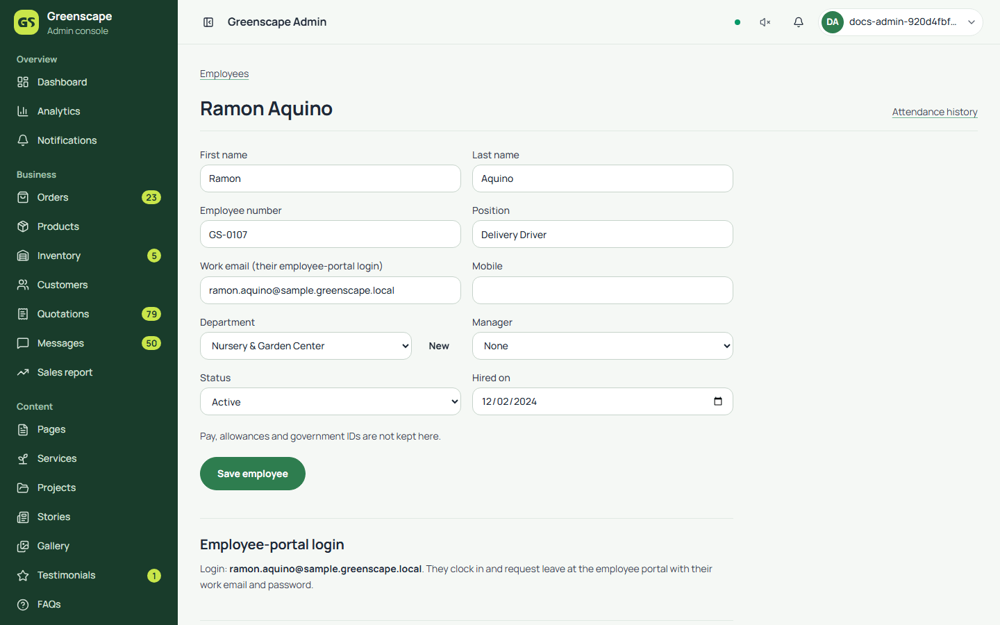
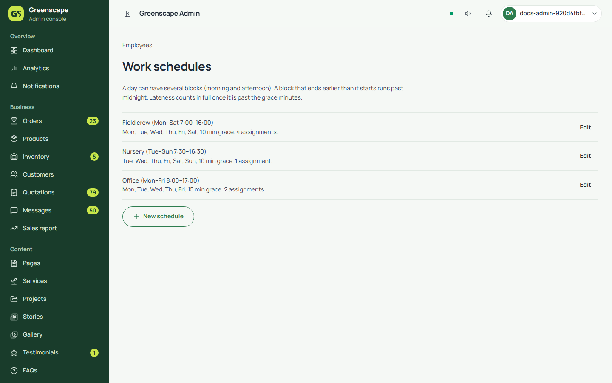
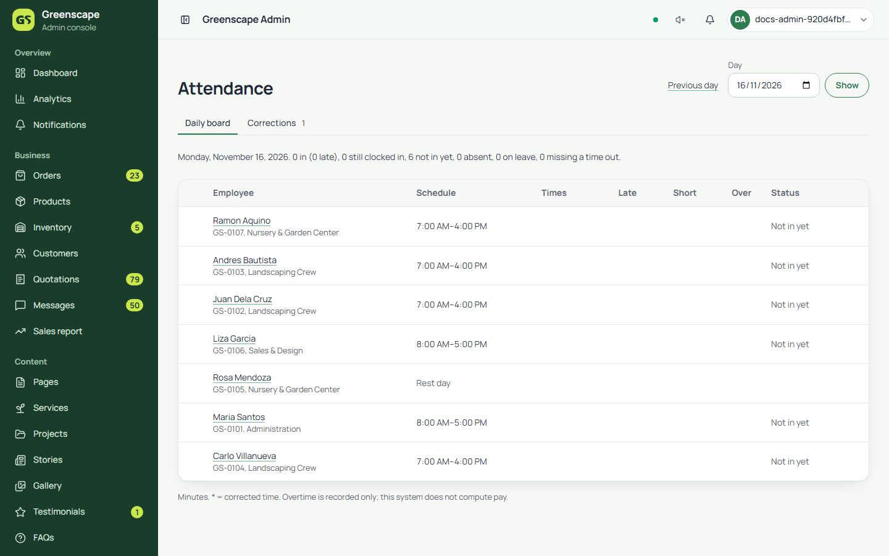
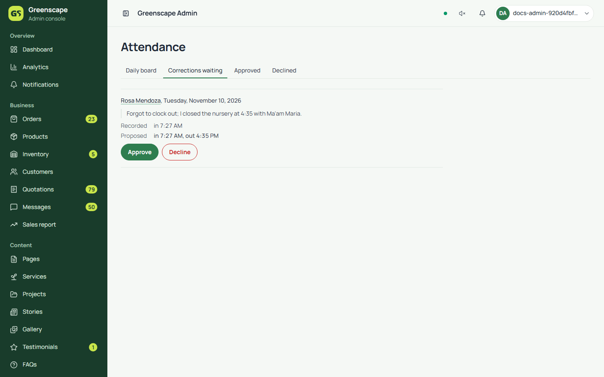
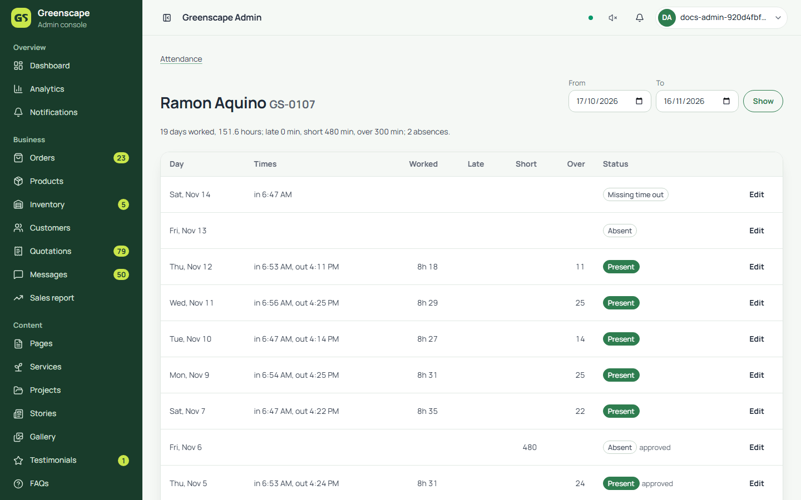
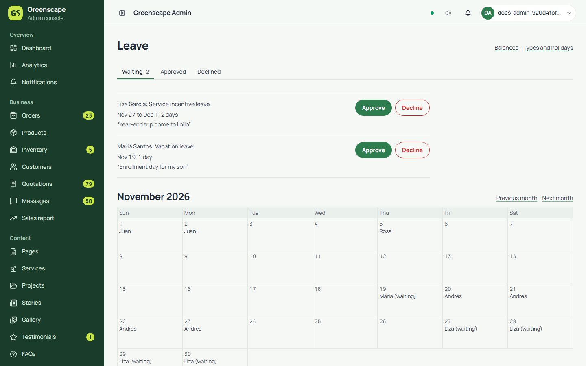
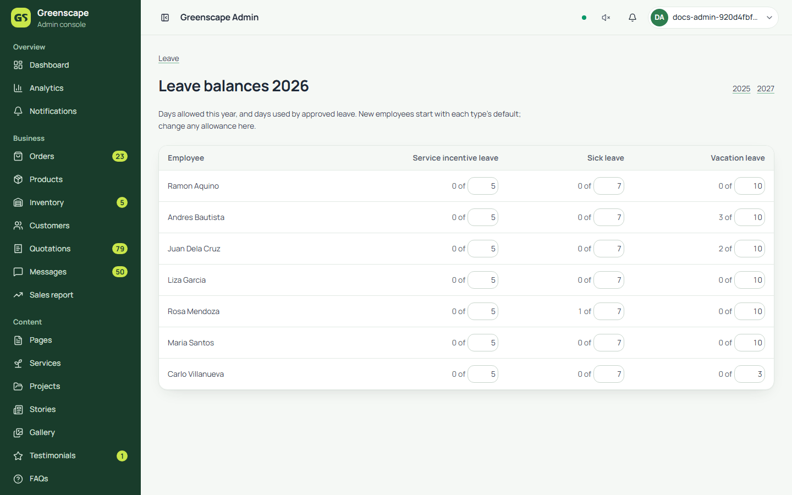
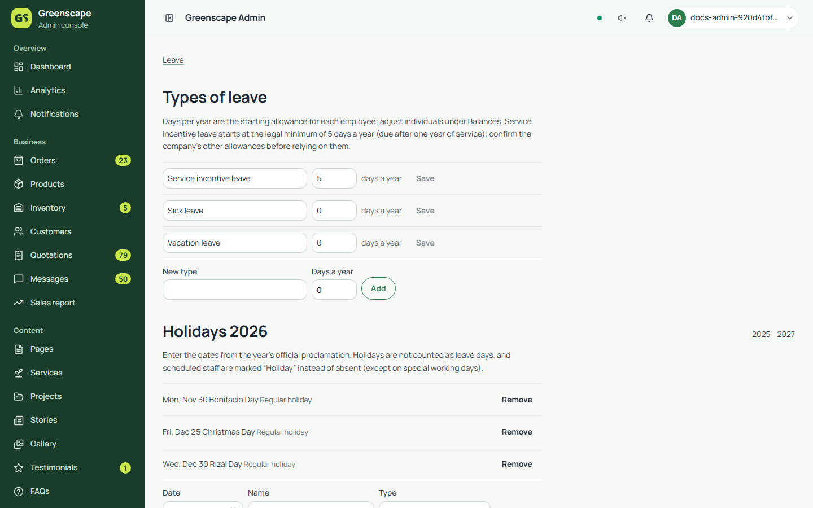
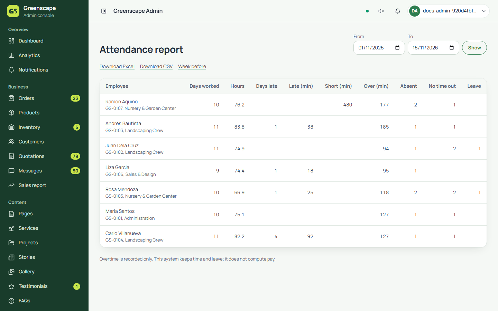

# HR and attendance

The Workforce group of the admin console: employee records and logins, work schedules, the attendance board,
corrections, leave and the attendance report. The employee's side: [employee portal](../employee/portal.md). Rules:
[attendance-system.md](../employee/attendance-system.md). Diagram: [attendance workflow](../architecture/diagrams.md#8-employee-attendance).

**Permissions** `employees.read` / `employees.manage`, `attendance.read` / `attendance.manage` / `attendance.approve`,
`leave.read` / `leave.approve`, `reports.attendance`. Built-in role: `hr_manager`. **Nobody approves their own
records or leave**, whatever their role. No payroll (D5).

Screenshots: the employees are the synthetic sample staff (`pnpm staff:seed`, `@sample.greenscape.local`) plus the
capture run's own demo employee.

---

## Employees

**URLs** `/employees`, `/employees/new`, `/employees/[id]` · **Source** `apps/admin/app/(console)/employees/`,
`components/employee-form.tsx`, `provision.tsx`

| List | Employee record |
|---|---|
|  |  |

Add employee: [employee-new-desktop.png](../assets/screenshots/admin/employees/employee-new-desktop.png)

| Feature | Behaviour |
|---|---|
| Records | Employee number, name, contact, department, manager, status; search; empty state "No employees yet" |
| Schedule assignment | A work schedule from a date (history kept) |
| **Create login** | Creates the Supabase identity with the `employee` role and shows a one-time temporary password once (never stored or emailed); the employee must change it at first sign-in |
| Link existing account | Link a website account by email instead |
| Audit | Changes to employee records are in the audit log |

Diagram: [employee authentication](../architecture/diagrams.md#3-employee-authentication). Details:
[employee-provisioning.md](../auth/employee-provisioning.md).

---

## Work schedules

**URL** `/employees/schedules` · **Source** `apps/admin/app/(console)/employees/schedules/page.tsx`, `components/schedules-editor.tsx`

Named schedules with shifts per weekday (split shifts and overnight shifts supported), grace minutes and flexible
days. Changing an assigned schedule notifies the affected employees.

---

## Attendance board and corrections

**URLs** `/attendance`, `/attendance/employee/[id]`, `/attendance/corrections` · **Source** `apps/admin/app/(console)/attendance/`,
`components/attendance-board.tsx`, `employee-days.tsx`, `decision-buttons.tsx`

| Corrections queue | One employee's days |
|---|---|
|  |  |

| Feature | Behaviour |
|---|---|
| Daily board | Every employee for a date: time in/out, worked time, late / undertime / overtime, status (present, late, absent, missing time out, leave, holiday, rest day); pick another date |
| Live | Updates as employees clock in and out, without a reload (`attendance` topic) |
| Approve | Approval is a separate stamp, so a day keeps its status; approve every approvable day on the board in one action |
| HR edit | Change a day's times with a reason (audited) |
| Selfies | When enabled, a link per punch to the private photo (short-lived signed URL) |
| Corrections | Proposed vs recorded times side by side, the reason and any attachment; approve or reject; the employee is notified |
| Employee history | One employee's days over time |

The day-close job (every 15 minutes, Redis-locked) marks absences and missing time-outs for the last two days.

### Video notes
Scene `full-12` and the split-screen `full-13`: the admin board in one browser profile, the employee portal in
another; clock in and watch the row change.

---

## Leave

**URLs** `/leave`, `/leave/balances`, `/leave/settings` · **Source** `apps/admin/app/(console)/leave/`,
`components/balances-table.tsx`, `leave-settings.tsx`, `cancel-leave.tsx`

| Balances | Leave settings |
|---|---|
|  |  |

- **Requests**: queue with a month calendar; approve (row-locks the balance and marks the days) or reject; cancelling
  an approved leave returns the days.
- **Balances**: yearly balance per employee and leave type.
- **Settings**: leave types (service incentive leave seeded at the statutory 5 days; vacation and sick at 0 for HR to
  set), holidays (regular, special non-working, special working) and **clock-in selfies** (off / optional / required,
  retention period; `components/selfie-settings.tsx`).

---

## Attendance report

**URL** `/reports/attendance` · **Permission** `reports.attendance`

Per employee for a period: days present, late, absent, undertime, overtime (recorded only), leave; table, CSV and
XLSX.
