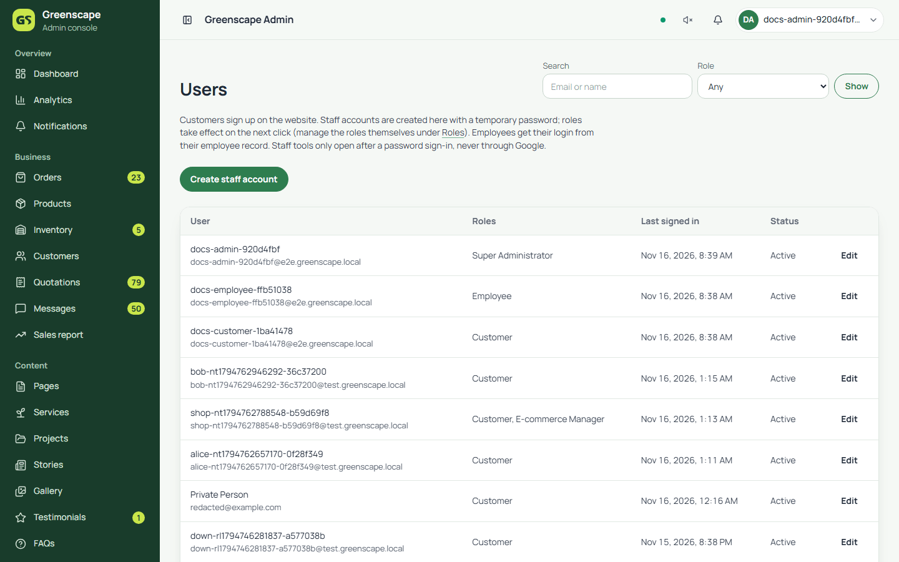
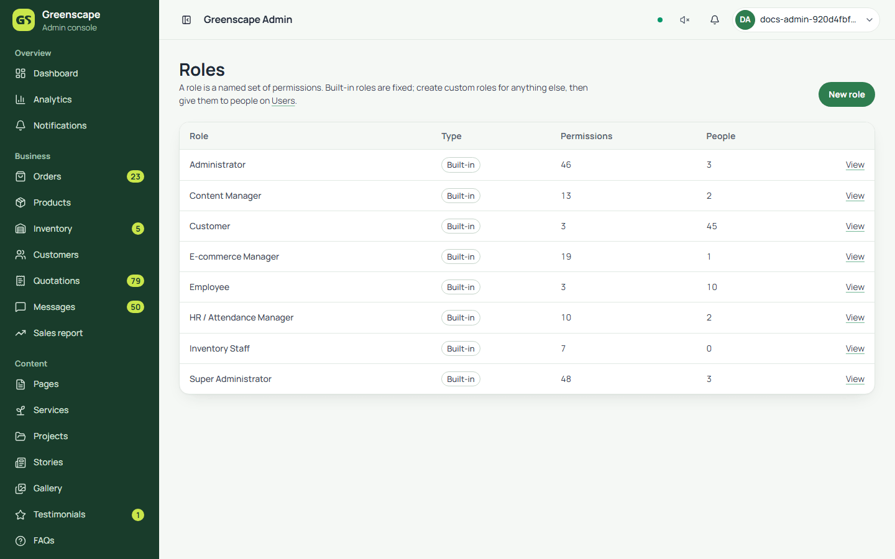
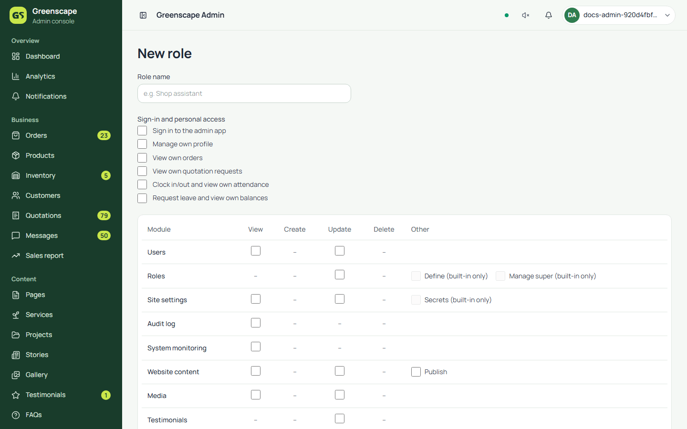
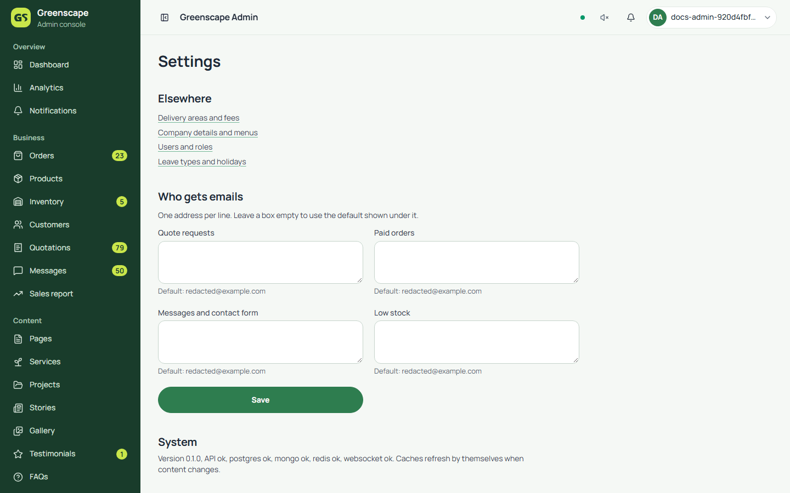
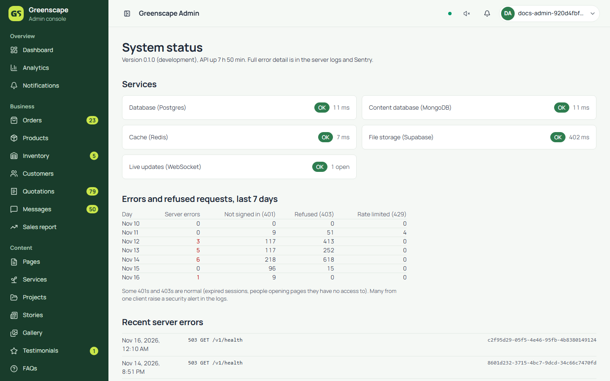
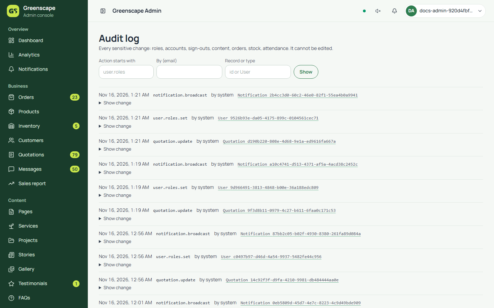
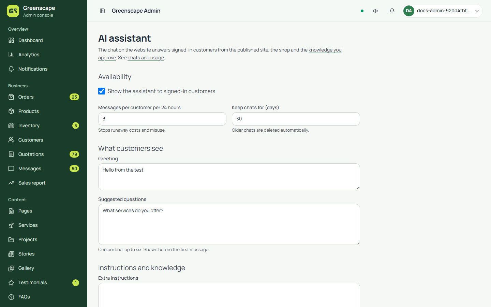
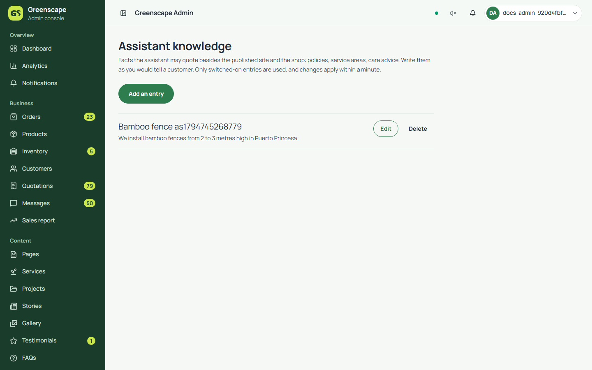

# Users, roles, settings, system and assistant

The Administration group of the admin console. Security background: [authorization-matrix.md](../security/authorization-matrix.md),
[role-permissions.md](../auth/role-permissions.md), [monitoring.md](monitoring.md).

---

## Users

**URL** `/users` · **Permission** `users.read` / `users.manage` · **Source** `apps/admin/app/(console)/users/page.tsx`,
`components/users-table.tsx`

| Feature | Behaviour |
|---|---|
| Find people | Search by email or name; filter by role; 25 per page |
| Roles | Tick roles per person; changes take effect within seconds (permission cache invalidated) and are audited |
| Protected roles | Only a super admin can grant or remove `admin` / `super_admin` |
| Nobody edits themselves | Your own row is read-only |
| Create staff account | Email + temporary password shown once; the person must change it at first sign-in |
| Suspend / reactivate | Suspension also ends every session |
| Sign out everywhere | Revokes all of a person's sessions (`POST /v1/users/:id/sessions/revoke`) |

In the documentation screenshots every non-synthetic email address is replaced with `redacted@example.com` and the
names and phone numbers of real accounts with "Private Person"; the capture refuses to save a picture that still
shows one.

---

## Roles

**URLs** `/users/roles`, `/users/roles/[key]` · **Permission** `users.read`; editing needs `roles.define` /
`roles.manage` · **Source** `apps/admin/app/(console)/users/roles/`, `components/role-editor.tsx`

| Roles | Role editor |
|---|---|
|  |  |

Eight built-in roles (read-only definitions) and **custom roles**: a name and any set of permissions, grouped by area.
The admin menu and dashboard follow the permissions automatically.

---

## Settings

**URL** `/settings` · **Permission** `settings.read` / `settings.manage` · **Source** `apps/admin/app/(console)/settings/page.tsx`,
`components/notifications-form.tsx`

- **Who gets emails**: recipients for new quotations, orders, messages and low stock (stored in the database, the
  environment value as fallback).
- **Elsewhere**: links to company details and menus, delivery areas and fees, leave types and holidays, users and
  roles, system.

---

## System status

**URL** `/system` · **Permission** `system.monitor` · **Source** `apps/admin/app/(console)/system/page.tsx`; API
`/v1/admin/system`

| Section | Shows |
|---|---|
| Services | PostgreSQL, MongoDB, Redis, Storage and WebSocket checks with latency, version and uptime; "Down" when one fails |
| Server errors | 7-day counts of 5xx, 401, 403 and 429 responses |
| Recent server errors | The last 20, without personal data |
| Payment webhooks | Failed and stuck webhook events |
| Push notification jobs | Failed and overdue deliveries |

The API's own health endpoint (`/v1/health`) runs the same dependency checks for uptime monitors.

---

## Audit log

**URL** `/audit` · **Permission** `audit.read` · **Source** `apps/admin/app/(console)/audit/page.tsx`

Every sensitive change (roles, prices, stock adjustments, refunds, employee records, attendance edits and approvals,
settings) with actor, time, record and before/after values; filter by action, actor and record.

---

## AI assistant

**URLs** `/assistant`, `/assistant/knowledge`, `/assistant/conversations`, `/assistant/conversations/[id]` ·
**Permission** `assistant.manage` (settings, knowledge), `assistant.read` (conversations) · **Source**
`apps/admin/app/(console)/assistant/`, `components/assistant-settings-form.tsx`, `knowledge-manager.tsx`

| Settings | Knowledge |
|---|---|
|  |  |

Conversations: [assistant-conversations-desktop.png](../assets/screenshots/admin/assistant/assistant-conversations-desktop.png)

- **Settings**: availability, provider and model (Anthropic or an OpenAI-compatible endpoint), instructions and
  knowledge, what customers see.
- **Knowledge**: entries the assistant may answer from.
- **Conversations**: signed-in customers' chats for review.

The assistant needs a provider key in the API environment. Details: [auth/ai-assistant.md](../auth/ai-assistant.md).
