# Architecture diagrams

Thirteen diagrams of the system **as built**, drawn from the code. Each one links to the page that covers that part
in prose. Where the code differs from the original brief, the
[stack discrepancies](../overview/system-status.md#stack-discrepancies) table says how.

Contents:
1. [Overall architecture](#1-overall-architecture)
2. [Customer authentication](#2-customer-authentication)
3. [Employee authentication](#3-employee-authentication)
4. [Admin authentication and authorization](#4-admin-authentication-and-authorization)
5. [PostgreSQL and MongoDB responsibilities](#5-postgresql-and-mongodb-responsibilities)
6. [CMS publishing and cache invalidation](#6-cms-publishing-and-cache-invalidation)
7. [Purchase and payment](#7-purchase-and-payment)
8. [Employee attendance](#8-employee-attendance)
9. [Socket.IO communication](#9-socketio-communication)
10. [Web Push delivery](#10-web-push-delivery)
11. [PWA installation and offline behavior](#11-pwa-installation-and-offline-behavior)
12. [Docker and Dokploy deployment](#12-docker-and-dokploy-deployment)
13. [CI/CD and the production branch](#13-cicd-and-the-production-branch)

## 1. Overall architecture

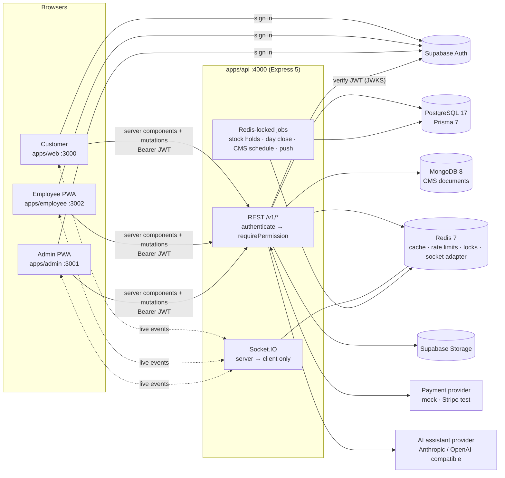

Browsers never reach Postgres, MongoDB or Redis. The only direct browser → Supabase calls are sign-in and uploads to
signed URLs the API issued. More: [architecture.md](../architecture.md),
[multi-portal-system.md](multi-portal-system.md).

## 2. Customer authentication

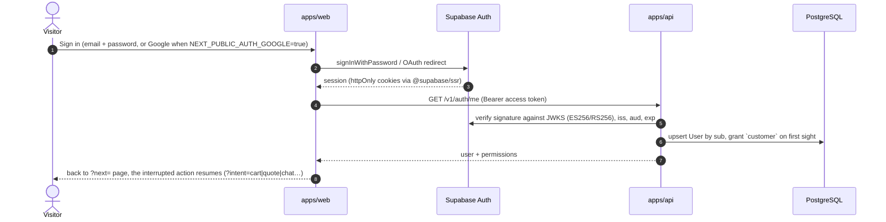

Google sessions keep **customer permissions only**, even for a staff member: internal tools need a password
sign-in. More: [auth/supabase-authentication.md](../auth/supabase-authentication.md),
[auth/google-oauth.md](../auth/google-oauth.md).

## 3. Employee authentication

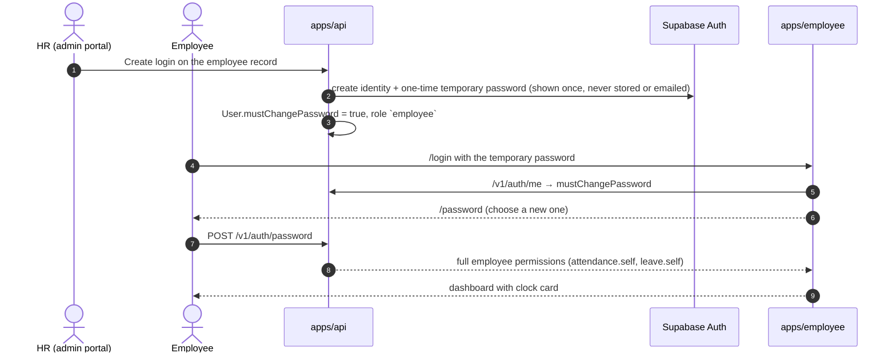

Employees never self-register; there is no Google button on this portal. More:
[auth/employee-provisioning.md](../auth/employee-provisioning.md).

## 4. Admin authentication and authorization

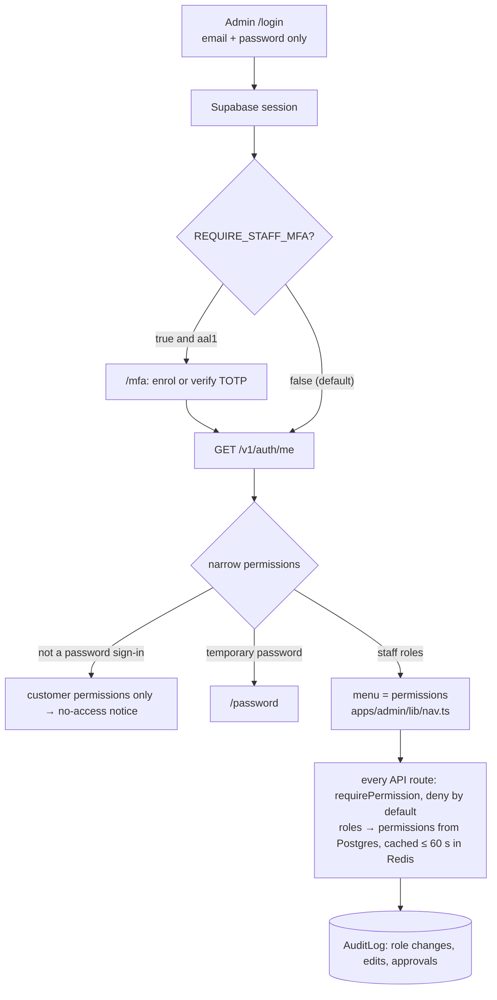

8 built-in roles plus custom roles edited at `/users/roles`. More:
[auth/role-permissions.md](../auth/role-permissions.md),
[security/authorization-matrix.md](../security/authorization-matrix.md).

## 5. PostgreSQL and MongoDB responsibilities

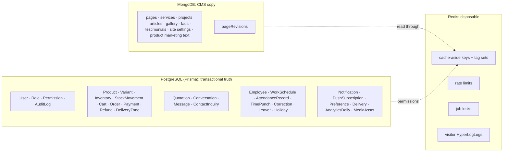

Never cached: stock, carts, checkout totals, payment status, attendance approvals. Schema:
[database-schema.md](../database-schema.md).

## 6. CMS publishing and cache invalidation

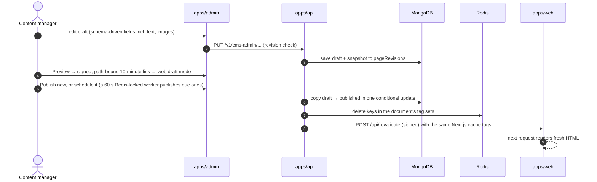

More: [admin/cms-management.md](../admin/cms-management.md), [architecture.md §6](../architecture.md#caching).

## 7. Purchase and payment

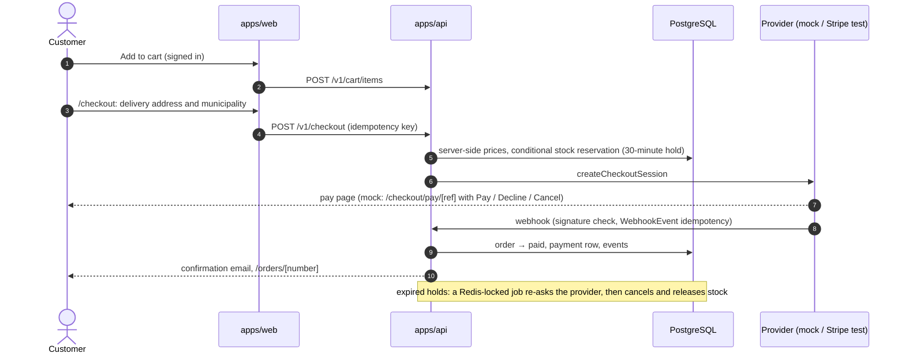

The UI shows a "Test mode — no real charge" banner. Live Stripe keys are refused. More:
[security/payment-security.md](../security/payment-security.md).

## 8. Employee attendance

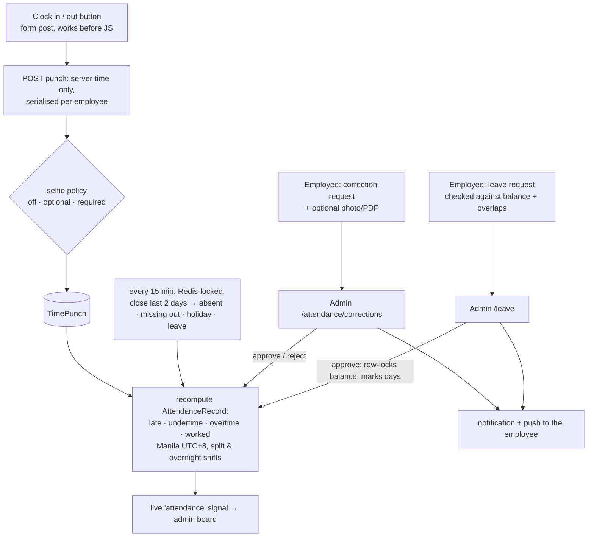

No payroll, pay or government-ID fields exist anywhere. More:
[employee/attendance-system.md](../employee/attendance-system.md).

## 9. Socket.IO communication

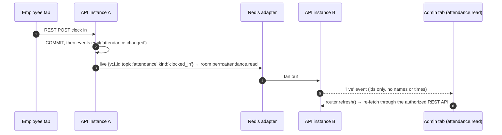

Clients never emit; a client that does is disconnected. More: [realtime/README.md](../realtime/README.md).

## 10. Web Push delivery

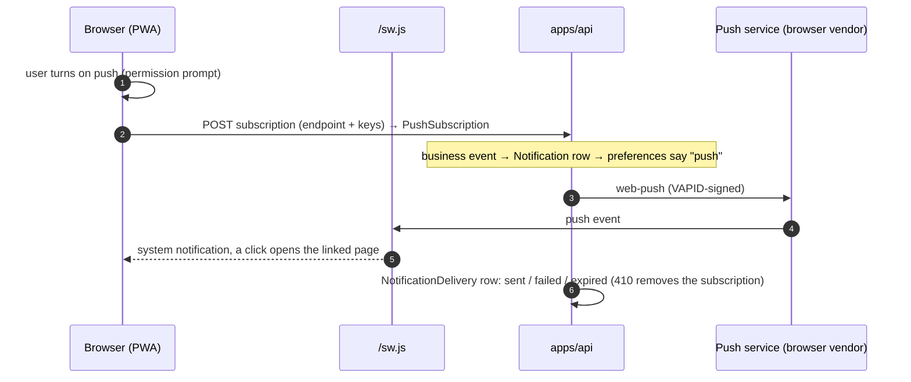

Needs `VAPID_PUBLIC_KEY` / `VAPID_PRIVATE_KEY` (`pnpm vapid:keys`); without them push is off and the in-app bell
still works. More: [notifications.md](../notifications.md).

## 11. PWA installation and offline behavior

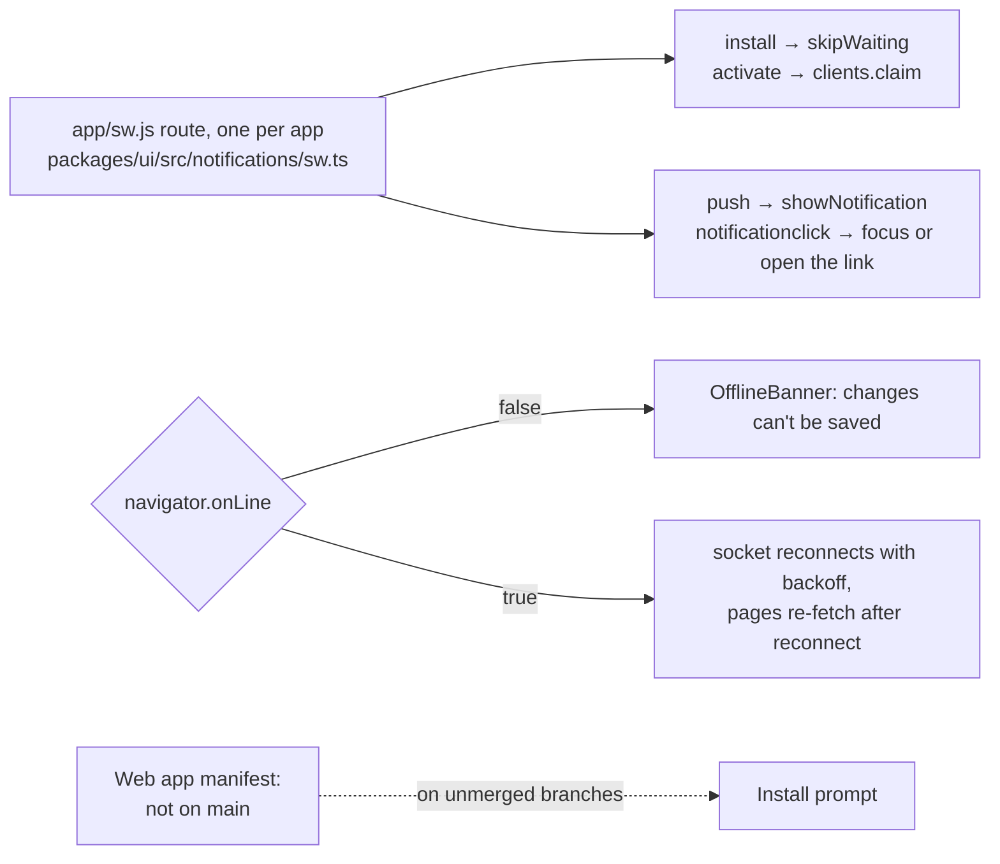

**As built on `main`:** the service worker exists for **push only**. It has no `fetch` handler, so nothing is
cached for offline use, and offline shows as a banner (`packages/ui/src/components/offline.tsx`). There is **no web
app manifest** on `main` (`apps/*/app/manifest.ts` is absent), so browsers do not offer to install the portals yet.
Admin and employee manifests exist on the unmerged branches `claude/greenscape-pwa-branding-09917e` and
`claude/pwa-push-gaps`. See [system status](../overview/system-status.md).

## 12. Docker and Dokploy deployment

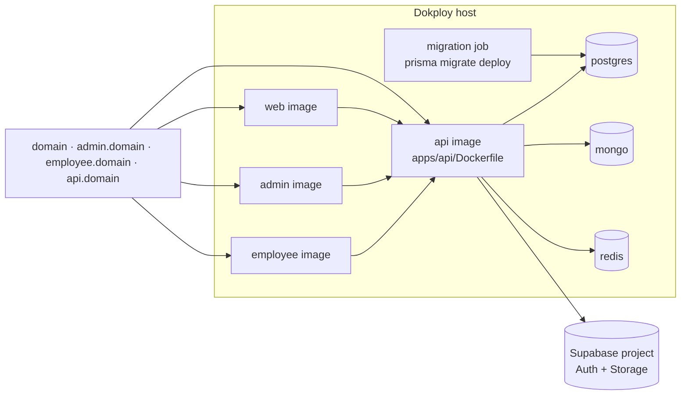

One image per service, built from the repository root. More: [deployment/dokploy.md](../deployment/dokploy.md),
[deployment/subdomains.md](../deployment/subdomains.md).

## 13. CI/CD and the production branch

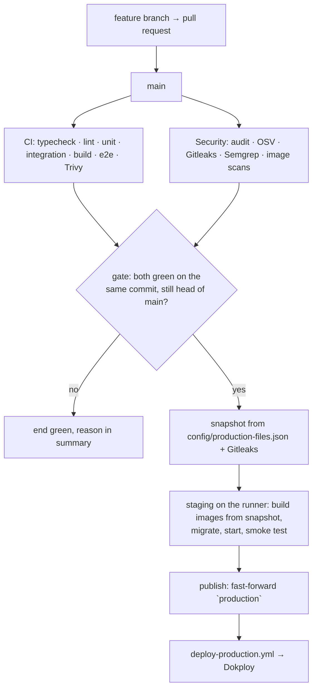

More: [deployment/ci-cd-pipeline.md](../deployment/ci-cd-pipeline.md),
[deployment/production-branch.md](../deployment/production-branch.md).
