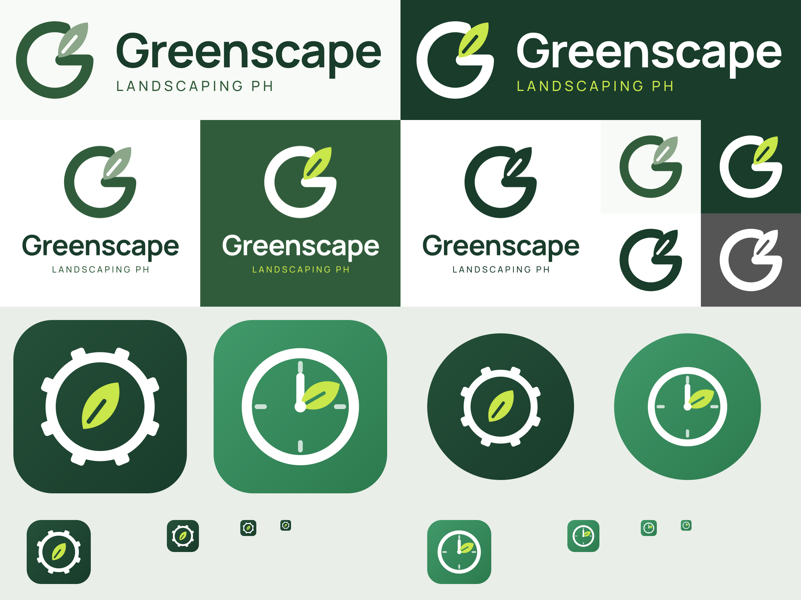

# Logo guidelines

## The mark

A **G drawn as an open ring, with a leaf growing out of its bar**. It keeps the "G" of the previous icon (a bold letter G) and the leaf the portals already used, and joins them into one shape that survives at 16 px.

The wordmark is "Greenscape" in Manrope Bold with "LANDSCAPING PH" in tracked Manrope Medium. In the SVG files the text is outlines, so no font is needed.

## Colours

| Name | Hex | Use |
|---|---|---|
| Botanical Green | `#315C3B` | Ring on light backgrounds, tagline |
| Deep Forest Green | `#193C2B` | Wordmark on light, dark backgrounds, Admin icon |
| Sage Green | `#8CA68A` | Leaf on light backgrounds |
| Fresh Lime | `#C9E64A` | Leaf and tagline on dark backgrounds |
| White | `#FFFFFF` | Ring and wordmark on dark backgrounds |
| Soft Background | `#F8FAF7` | Light background |
| Fresh Green | `#368A5B` | Employee app (existing portal colour) |

## Variants (`packages/branding/logos/`)

| File | Use |
|---|---|
| `greenscape-horizontal.svg` | Default, light backgrounds |
| `greenscape-horizontal-dark.svg` | Dark or green backgrounds |
| `greenscape-horizontal-mono.svg` | One colour (`currentColor`): stamps, engraving, single-ink print |
| `greenscape-stacked.svg`, `-dark`, `-mono` | Square spaces: social avatars, signage |
| `greenscape-mark.svg`, `-dark`, `-mono` | Icon only |

All have transparent backgrounds. The mono files take the colour of the surrounding text when inlined; opened alone they are black.

## Rules

- Clear space: at least the width of the ring's stroke on every side.
- Smallest size: mark 16 px; horizontal logo 120 px wide (below that, use the mark alone).
- Do not recolour outside the palette, stretch, rotate, add shadows or outlines, or set the lime leaf on a light background (it disappears: use the light variant).
- Do not rebuild the wordmark in another typeface.

## Changing the artwork

Edit the geometry in `scripts/brand-assets.mjs` and run `node scripts/brand-assets.mjs`. Every SVG, every app icon and the contact sheet are regenerated from it. The in-app mark (`packages/ui/src/layout/brand-mark.tsx`) holds a copy of the two paths: update it if the mark changes.

## Originals

The previous icons are kept in `packages/branding/original/`. The customer site (`apps/web`) still uses them; moving it to the new mark is a separate decision.
