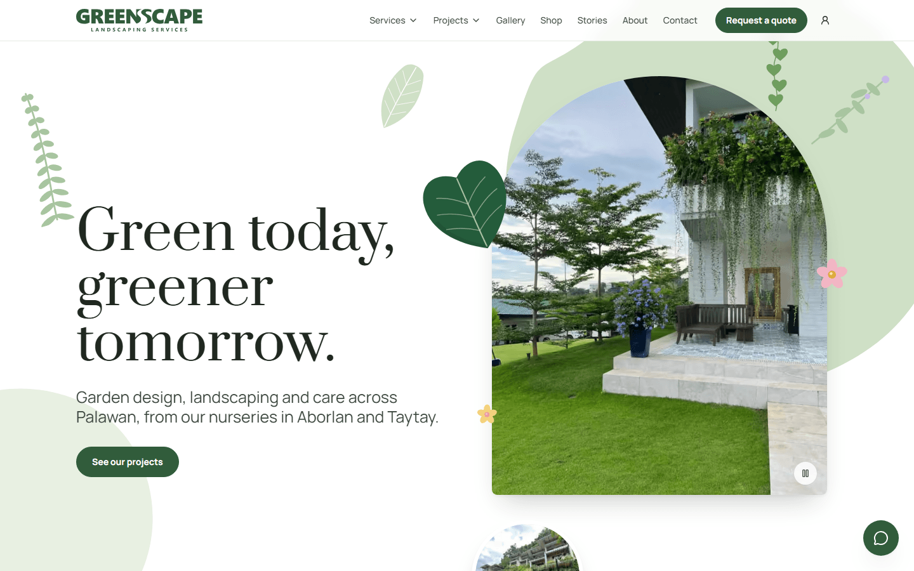

# Customer website

`apps/web` · local http://localhost:3000 · production `<domain>`

The public face of Greenscape: landscaping services, a project portfolio and photo gallery, stories, an online plant
shop, quotation requests and customer accounts. Browsing is public; buying, quotes, messages, reviews and the AI
assistant need a signed-in account (the API enforces this).

## Pages

| Guide | Routes |
|---|---|
| [Home and content pages](site-pages.md) | `/`, `/about`, `/stories`, `/stories/[slug]`, `/testimonials`, `/faq`, `/contact`, `/quote`, `/delivery-policy`, `/privacy`, `/[slug]`, `/design`, 404 and error pages |
| [Services, projects and gallery](services-projects-gallery.md) | `/services`, `/services/[slug]`, `/projects`, `/projects/[slug]`, `/gallery` |
| [Shop, cart and checkout](shop.md) | `/shop`, `/shop/[slug]`, `/cart`, `/checkout`, `/checkout/pay/[ref]`, `/orders/[number]` |
| [Sign-in and account](account.md) | `/auth/login`, `/auth/register`, `/auth/forgot-password`, `/auth/reset-password`, `/account`, `/account/notifications`, `/messages` |

## Shared layout

- **Header** (sticky, white, gains a shadow on scroll): Greenscape wordmark; Services and Projects menus; Gallery,
  Shop, Stories, About, Contact; **Request a quote** button; account icon (and cart count once something is in it).
  On phones the menu collapses into a sheet.
- **Footer** (deep green): wordmark and tagline; Services, Shop, Company and Contact columns; Facebook and Instagram;
  privacy link.
- **AI assistant** button (bottom right) on every page: opens the chat for signed-in visitors, otherwise asks them to
  sign in and reopens the chat afterwards.
- **Motion**: CSS scroll-driven reveals and parallax, no motion library on public pages; everything is visible with
  reduced motion or without JavaScript.
- **Content source**: copy, services, projects, stories, gallery and FAQs come from the MongoDB CMS through the API,
  cached in Redis and revalidated when staff publish ([admin CMS](../admin/cms.md)).

## Access

| Visitor | Can |
|---|---|
| Guest | Browse every public page, the catalogue and prices |
| Signed-in customer | Cart, checkout, quotes, contact form, messages, reviews, wishlist, AI assistant, account |
| Staff signed in with Google | Customer permissions only on every portal (internal tools need a password sign-in) |

Source: `apps/web/app/`, `apps/web/components/`, shared UI in `packages/ui/`. Tests: `tests/e2e/public-site.spec.ts`,
`redesign.spec.ts`, `shop.spec.ts`, `auth.spec.ts`, `tests/e2e/auth/`.
