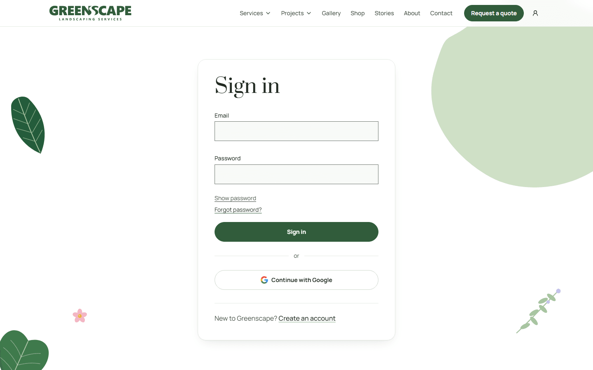
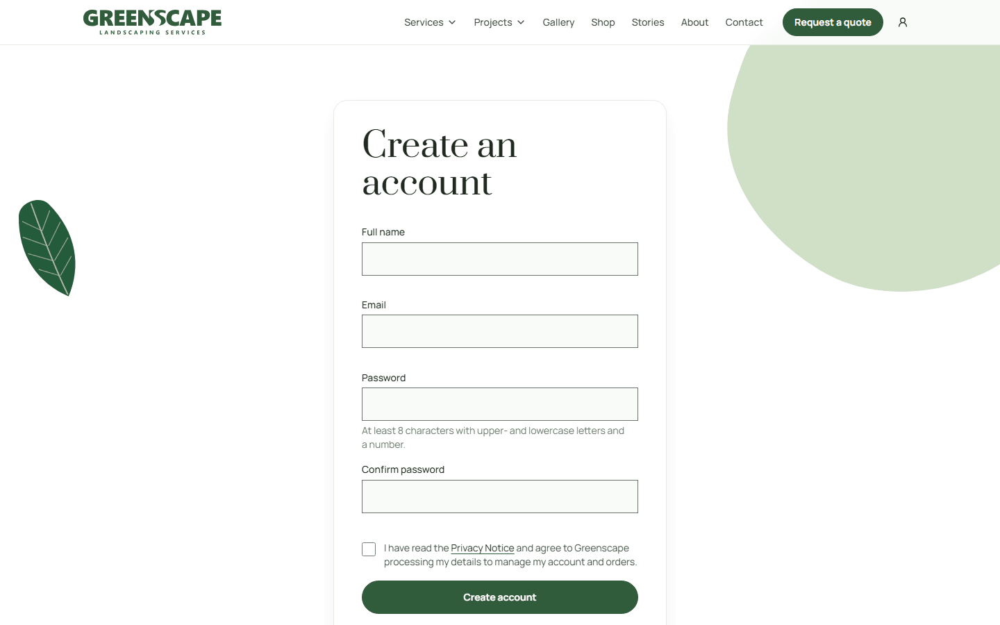
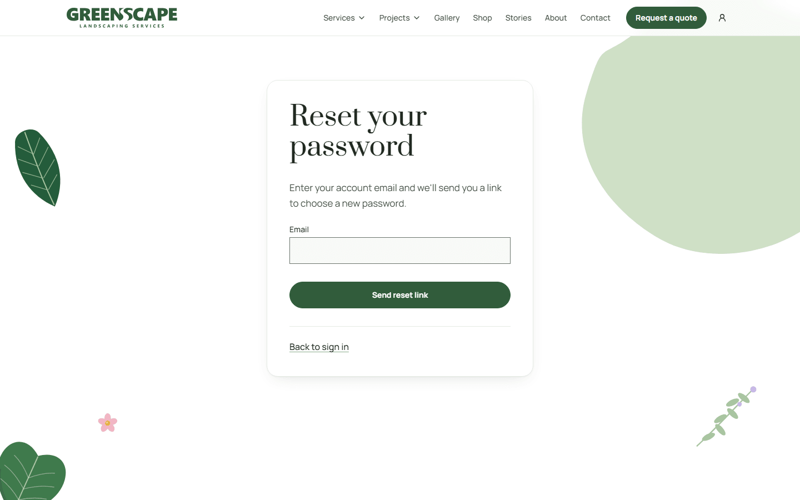
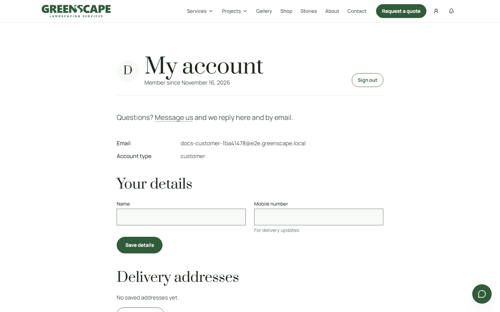
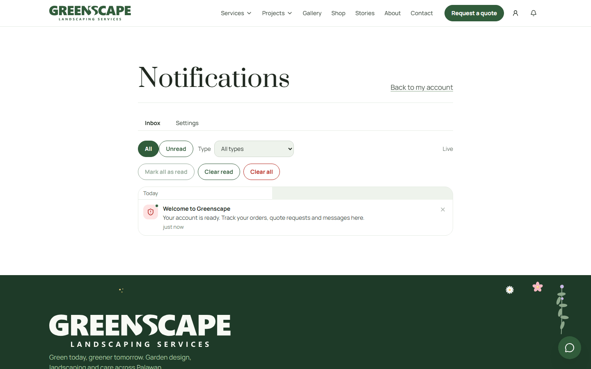
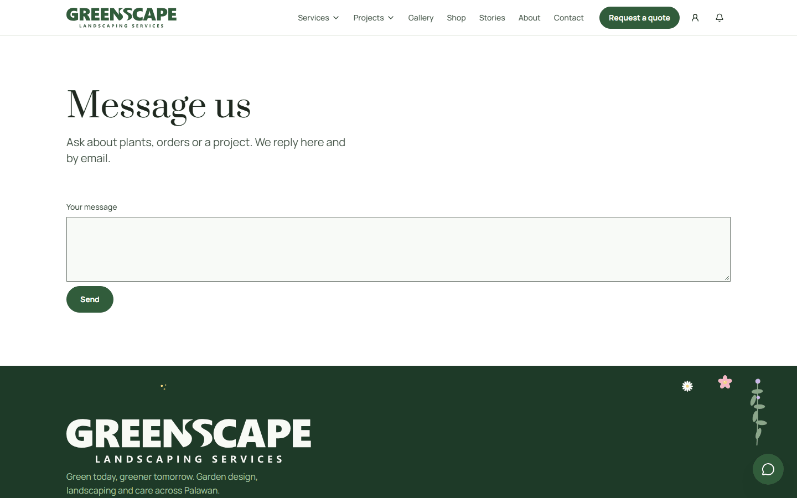

# Sign-in and account

Customer identity on the website: sign-in, registration and password recovery through Supabase Auth, and the
signed-in pages (My account, notifications, messages). Flow diagram:
[customer authentication](../architecture/diagrams.md#2-customer-authentication). Details:
[auth/supabase-authentication.md](../auth/supabase-authentication.md), [auth/google-oauth.md](../auth/google-oauth.md).

---

## Sign in, register, recover

**URLs** `/auth/login`, `/auth/register`, `/auth/forgot-password`, `/auth/reset-password` · **Access** public ·
**Source** `apps/web/app/auth/`, `packages/ui` auth forms

| Sign in | Create an account | Reset your password |
|---|---|---|
|  |  |  |

| Feature | Behaviour | Status |
|---|---|---|
| Email + password sign-in | Server-side session cookies; full page load after sign-in; back to `?next=` with the interrupted action resumed (`?intent=cart`, `quote`, `contact`, `chat`, `wishlist`) | Implemented and verified |
| Registration | Email verification required; stronger password policy | Implemented and verified |
| Forgot / reset password | Emailed link → `/auth/reset-password` to choose a new one; an invalid link returns to sign-in with an error | Implemented and verified |
| Continue with Google | Shown when `NEXT_PUBLIC_AUTH_GOOGLE=true` and a Google OAuth client is configured in Supabase | Implemented, environment-gated |
| Sign out | Plain form POST to `/auth/signout` (works before the page hydrates) | Implemented and verified |

Security: a Google session (any sign-in that is not a password) gets **customer permissions only**, even for staff.
Locally, verification and reset emails arrive in the Mailpit inbox (http://127.0.0.1:54324).

Video: Google sign-in is a blocked scene (`blocked-01`): recording Google's page would expose a real account.
Scene `full-06` uses email sign-in with the synthetic demo customer.

---

## My account

**URL** `/account` · **Access** signed-in customer (guests are redirected to sign in) · **Source** `apps/web/app/account/page.tsx`,
`components/account/`

Phone: [account-mobile.png](../assets/screenshots/customer/account/account-mobile.png)

| Section | What it does | API |
|---|---|---|
| Your details | Name, phone; email shown | `GET/PATCH /v1/me/profile` |
| Delivery addresses | Add, edit, delete saved addresses for checkout | `/v1/me/addresses` |
| Your orders | Orders with status and links to `/orders/[number]`; empty state "Your orders will grow here" | `GET /v1/orders/mine` |
| Your quote requests | Reference, date, status | quotations (own) |
| Messages from the contact form | Inquiries and staff replies | `GET /v1/me/inquiries` |
| Chats with our AI assistant | Past assistant conversations | `/v1/assistant/conversations` |
| Wishlist | Saved products; remove | `/v1/me/wishlist` |
| Delete your account | Removes the account and personal data (confirmation required) | `DELETE /v1/me` |

The screenshot shows a new synthetic account, so the lists are in their empty states.

---

## Notifications

**URL** `/account/notifications` · **Access** signed-in customer · **Source** `apps/web/app/account/notifications/page.tsx`,
`packages/ui/src/notifications/`

Order, payment, quotation and message updates, with unread state, mark as read, and category preferences. New items
arrive live over Socket.IO; Web Push delivers them to the device when keys are configured
([notifications.md](../notifications.md)).

---

## Messages

**URL** `/messages` · **Access** signed-in customer · **Source** `apps/web/app/messages/page.tsx`, `components/message-form.tsx`

A two-way thread with the Greenscape team. The form works before JavaScript loads. Staff answer from the
[admin Messages inbox](../admin/commerce.md#messages); replies are emailed too. API: `GET/POST /v1/me/messages`.

---

## Related
[Shop and checkout](shop.md) · [Quotation request](site-pages.md#quotation-request) ·
[cross-portal access](../security/cross-portal-access.md)
