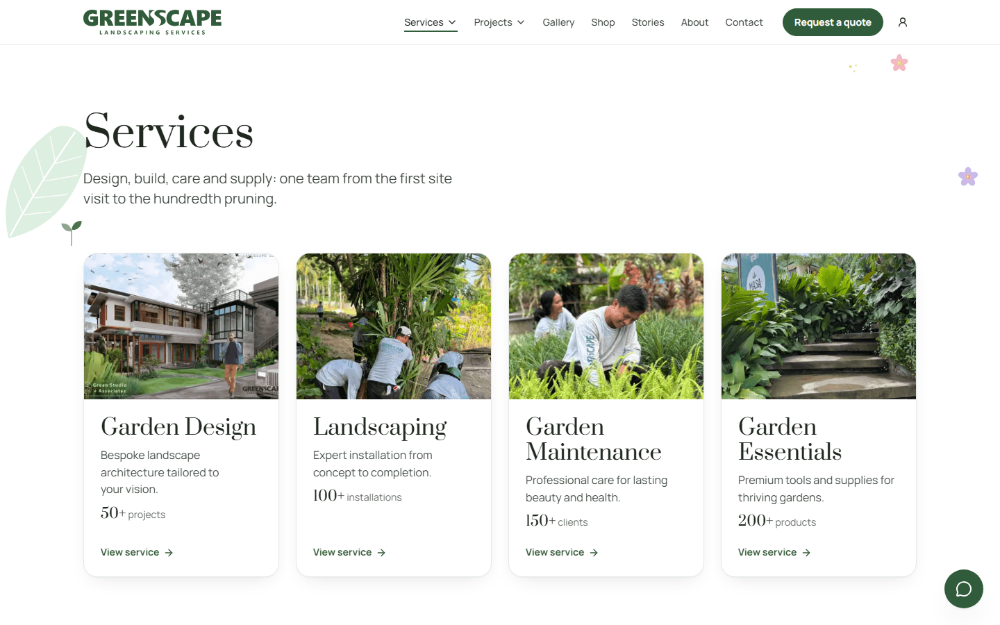
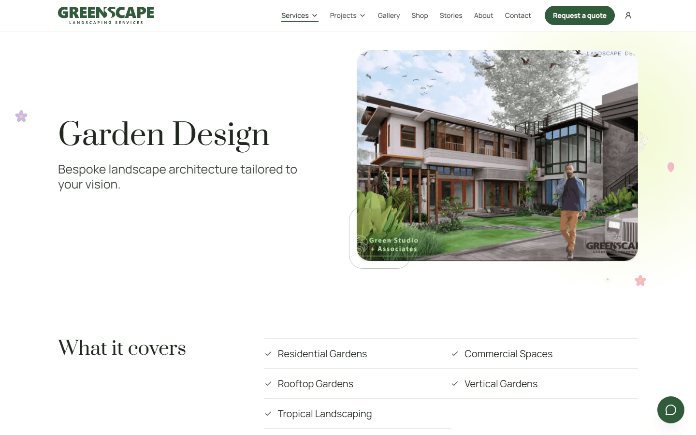
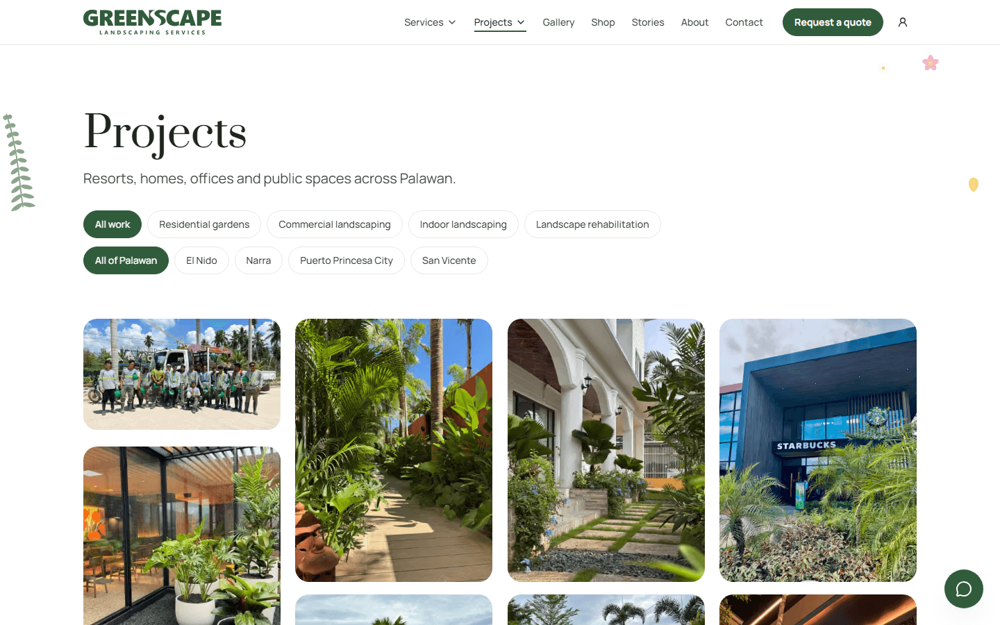
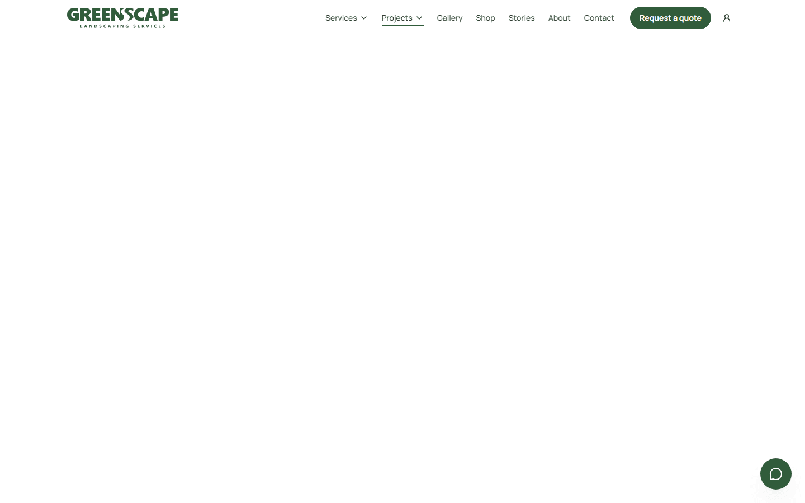
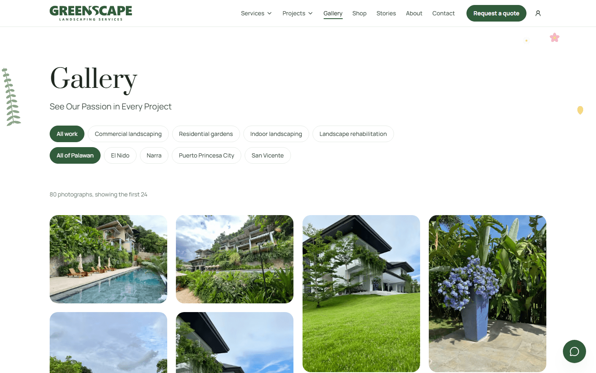
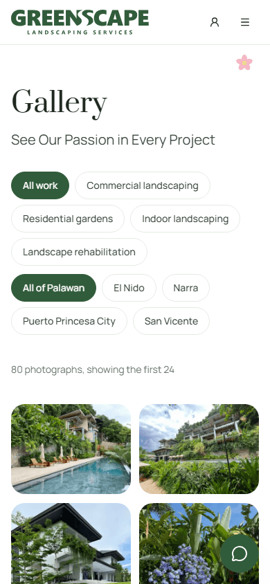
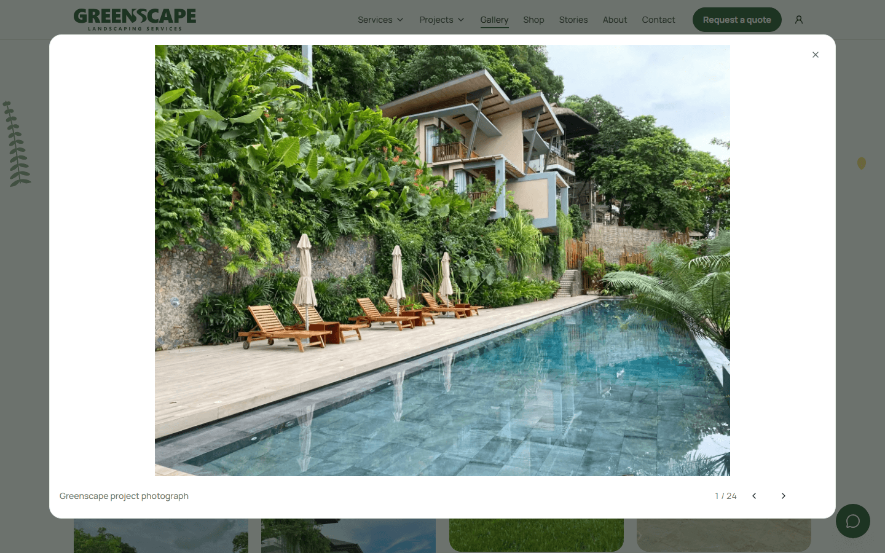

# Services, projects and gallery

What Greenscape does and proof that it does it well: the services with their packages, the project portfolio, and
the masonry photo gallery. All content comes from the MongoDB CMS through the API (Redis-cached, revalidated on
publish) and is edited in the [admin CMS](../admin/cms.md).

---

## Services

**URLs** `/services`, `/services/[slug]` · **Access** public · **Source** `apps/web/app/services/`,
`components/cards.tsx`, `components/before-after.tsx`, `components/sections.tsx`

### Overview
The service list introduces the four lines of work (Garden Design, Landscaping, Garden Maintenance, Garden
Essentials). Each service page explains the service and what it costs.

| List | Service page |
|---|---|
|  |  |

Phone: [services-mobile.png](../assets/screenshots/customer/services/services-mobile.png),
[service-detail-mobile.png](../assets/screenshots/customer/services/service-detail-mobile.png) · full page:
[service-detail-fullpage.png](../assets/screenshots/customer/services/service-detail-fullpage.png)

### Features of a service page
| Feature | Behaviour | Status |
|---|---|---|
| Introduction and photos | CMS rich text and images with blur placeholders | Implemented and verified |
| How a project runs | Numbered steps | Implemented and verified |
| Maintenance packages | Package cards with prices as published by staff | Implemented and verified |
| Before and after | Draggable comparison slider (keyboard accessible) | Implemented and verified |
| Guides from our growers | Related garden-essentials stories | Implemented and verified |
| Call to action | Request a quote | Implemented and verified |

Sections without content are left out of the page.

### Video notes
Scene `full-04`: open a service page, drag the before-and-after handle (callout on the handle).

---

## Projects

**URLs** `/projects`, `/projects/[slug]` · **Access** public · **Source** `apps/web/app/projects/`,
`components/gallery/masonry-*.tsx`, `components/share-links.tsx`

### Overview
The portfolio of finished gardens. The list is a Pinterest-style masonry of project cards that can be narrowed by
category (`?category=`, for example commercial, residential, rehabilitation). A project page tells the story: hero
photo, place and completion date, the write-up, an **On site** photo masonry, share links and related projects.

| List | Project page |
|---|---|
|  |  |

Full page: [projects-fullpage.png](../assets/screenshots/customer/projects/projects-fullpage.png),
[project-detail-fullpage.png](../assets/screenshots/customer/projects/project-detail-fullpage.png)

### How the masonry works
Pure CSS Grid: the server computes each card's row span from the stored image dimensions, so there is no layout
JavaScript, no reflow while images load, and the reading order stays the document order (accessible to keyboards and
screen readers). Details: [design/redesign-white-botanical.md](../design/redesign-white-botanical.md).

### States
"No projects match yet" when a category has none. Status: implemented and verified (`project-page.spec.ts`,
`redesign.spec.ts`).

---

## Gallery

**URL** `/gallery` · **Access** public · **Source** `apps/web/app/gallery/page.tsx`, `components/gallery/`
(`gallery-filters.tsx`, `masonry-grid.tsx`, `gallery-lightbox.tsx`)

### Overview
Every site photograph in one browsable masonry wall.

| Phone | Lightbox |
|---|---|
|  |  |

### Features
| Feature | Behaviour | Status |
|---|---|---|
| Filter by category | "All work" or one category | Implemented and verified |
| Filter by place | Narrow to one location | Implemented and verified |
| Show more | 24 photos at a time | Implemented and verified |
| Lightbox | Opens a photo full screen; previous / next buttons, arrow keys, swipe on phones; closes with Escape; loaded on first use | Implemented and verified |

### States
"No photographs match" when the filters exclude everything.

### Video notes
Scenes `full-04`, `promo-02`, `overview-02`: apply a filter, open a tile, step to the next photo.

---

## Related
[Home](site-pages.md#home) · [Quote request](site-pages.md#quotation-request) · [Admin CMS](../admin/cms.md)
