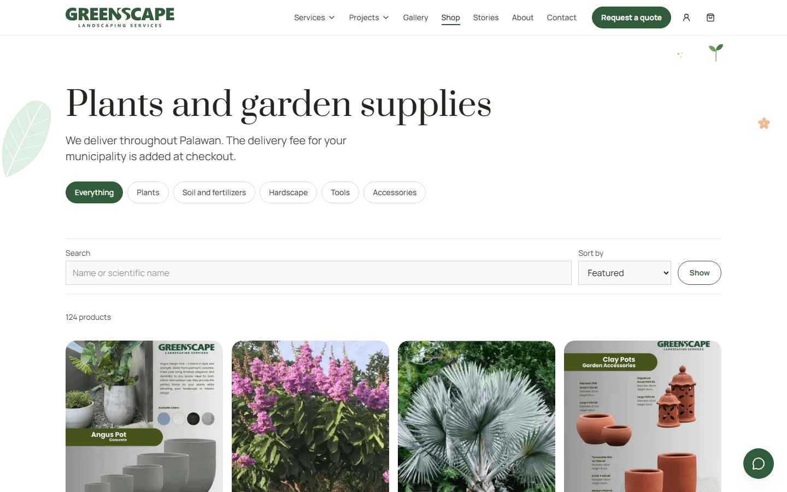
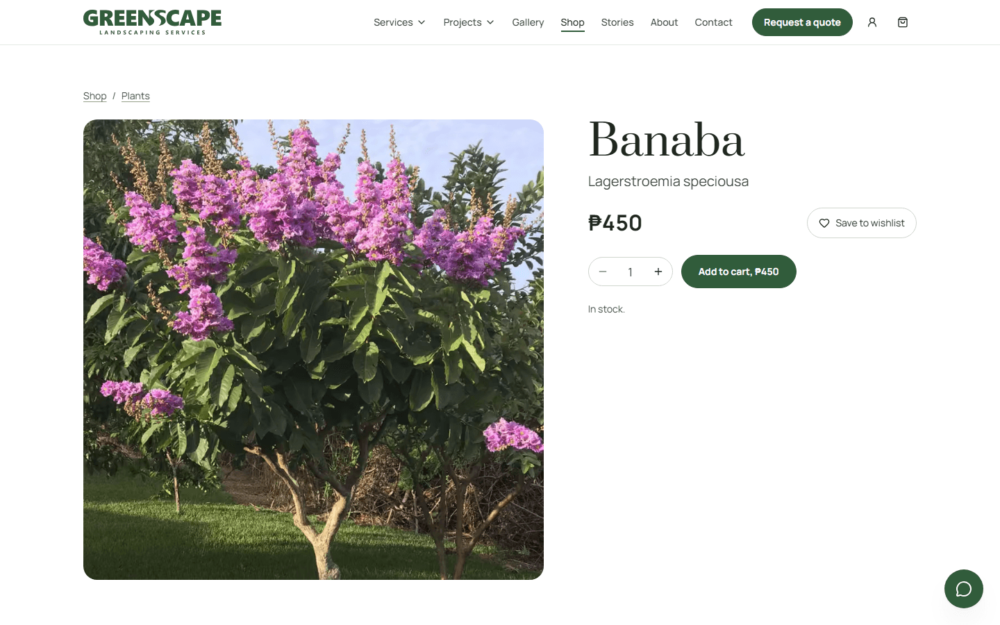
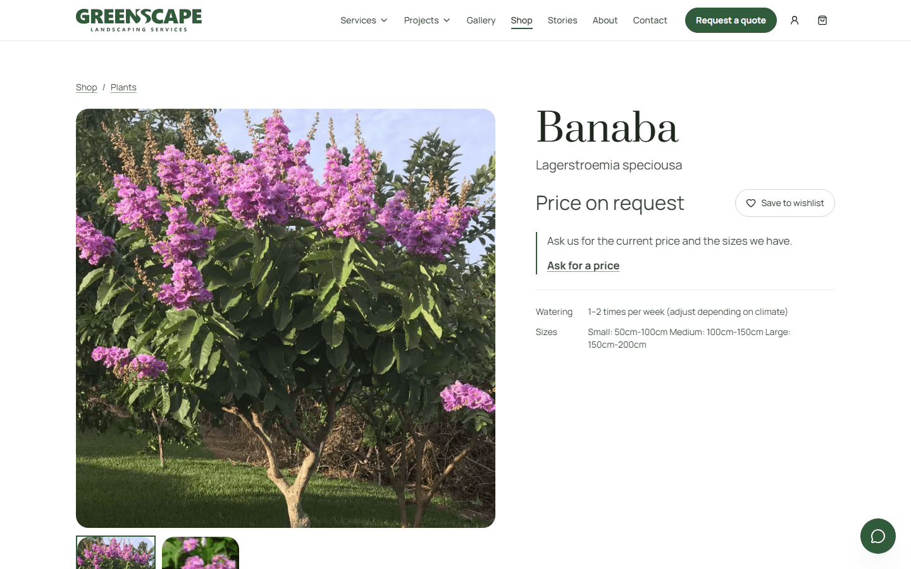
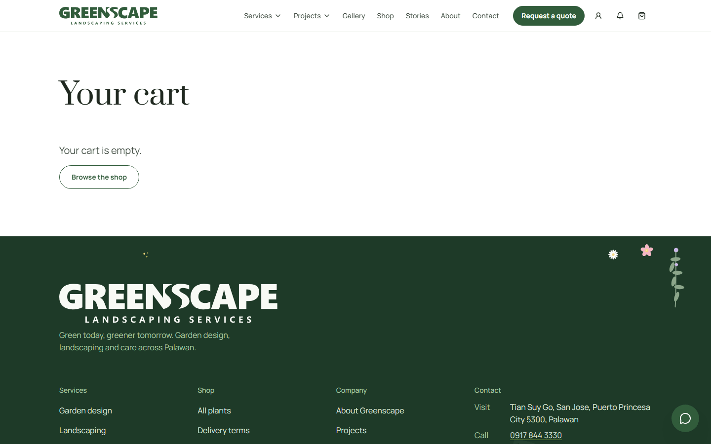
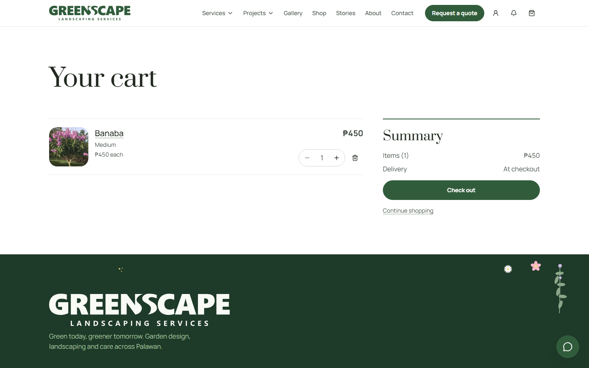
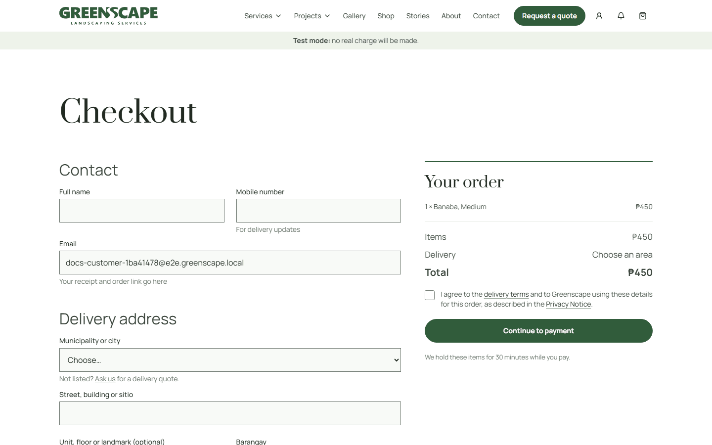

# Shop, cart and checkout

The online plant shop: catalogue, product pages, cart, checkout with stock holds, the test payment page and the order
page. Payments run through a provider interface; locally and in tests the **mock** provider is used, Stripe test mode
is available, live keys are refused. Staff side: [admin commerce](../admin/commerce.md).

---

## Catalogue

**URL** `/shop` (query: `category`, `plantType`, `q`, `sort`, `page`) · **Access** public · **Source**
`apps/web/app/shop/page.tsx`, `components/shop.tsx`

### Overview
"Plants and garden supplies", delivered throughout Palawan with the municipality's delivery fee added at checkout.

Phone: [shop-mobile.png](../assets/screenshots/customer/shop/shop-mobile.png) · full page:
[shop-fullpage.png](../assets/screenshots/customer/shop/shop-fullpage.png)

### Features
| Feature | Behaviour | Status |
|---|---|---|
| Category filter | "Everything" or one shop category (plants, soil and fertilizers, hardscape, tools and accessories…) | Implemented and verified |
| Plant type | Extra filter shown inside the plants category | Implemented and verified |
| Search | Name or scientific name; "Clear search" | Implemented and verified |
| Sort | Featured, Newest, Price low to high, Price high to low, Name | Implemented and verified |
| Product cards | Photo, name, "From ₱…" or **Price on request**, badges (Best seller, New) | Implemented and verified |
| Pagination | Numbered pages | Implemented and verified |

The search and filters are a plain GET form: they work before JavaScript loads and every result has a shareable URL.

### Data and caching
`GET /v1/shop/*` from PostgreSQL, product lists Redis-cached and invalidated on any product or price change. **Stock
is never cached.**

### States
"Nothing matches that yet" with **See everything** and a link to ask the team to source it.

---

## Product page

**URL** `/shop/[slug]` · **Access** public; adding to the cart needs an account · **Source** `apps/web/app/shop/[slug]/page.tsx`,
`components/buy-box.tsx`, `components/wishlist-button.tsx`

| Priced and in stock | Price on request |
|---|---|
|  |  |

The imported catalogue has no prices yet (the old site had none), so every real product currently shows **Price on
request**. The priced screenshot uses a temporary demo product that the capture run creates with a real product's
photo and deletes afterwards. Phone: [product-detail-mobile.png](../assets/screenshots/customer/shop/product-detail-mobile.png)

| Feature | Behaviour | Status |
|---|---|---|
| Photos | Main photo and **More photos** | Implemented and verified |
| Size | Choose a size; price follows the size | Implemented and verified |
| Live stock | Fetched uncached: "In stock.", or "Sold out for now." with **Ask when it is back** | Implemented and verified |
| Quantity and Add to cart | One fewer / one more; the button shows the line total (**Add to cart, ₱450**); a guest is asked to sign in and returns with `?intent=cart` | Implemented and verified |
| Price on request | Products without a priced size show **Ask us** instead of buying | Implemented and verified |
| Wishlist | **Save to wishlist**, kept in the account | Implemented and verified |
| Care information | Rich text from MongoDB | Implemented and verified |
| SEO | Product JSON-LD | Implemented |

---

## Cart

**URL** `/cart` · **Access** signed-in (guest carts merge on sign-in) · **Source** `apps/web/app/cart/page.tsx`,
`components/cart-lines.tsx`

| Empty | With a product |
|---|---|
|  |  |

Lines with photo, size, quantity stepper and remove; a summary (delivery "At checkout"); **Check out** and **Continue shopping**. Empty state: "Your cart is empty." with **Browse the shop**. The header shows the item count
(`/api/cart/count`). API: `GET /v1/cart`, `POST /v1/cart/items`, `PATCH /v1/cart/items/:variantId`,
`POST /v1/cart/merge`. Status: implemented and verified.

---

## Checkout

**URL** `/checkout` · **Access** signed-in (guests are sent to `/auth/login?next=/checkout`; an empty cart goes back to
`/cart`) · **Source** `apps/web/app/checkout/page.tsx`, `components/checkout-form.tsx`

Full page: [checkout-fullpage.png](../assets/screenshots/customer/checkout/checkout-fullpage.png)

### Layout
A **Test mode: no real charge will be made** banner; *Your order* (items, delivery fee, total); contact (full name,
email "Your receipt and order link go here", mobile number "For delivery updates"); delivery address (municipality or
city from the active delivery areas, barangay, street, building or sitio, unit or landmark, postal code); privacy
consent; **Continue to payment**.

### Workflow
1. `POST /v1/checkout` with an idempotency key: a double click or retry never creates two orders.
2. The API prices everything server side, reserves stock conditionally (no overselling) and holds it for 30 minutes.
3. The provider session starts; the customer goes to the payment page.
4. The provider's webhook (signature-checked, recorded once) marks the order paid; emails go out.
5. Holds that expire are re-checked with the provider by a Redis-locked job before stock is released.

Diagram: [purchase and payment](../architecture/diagrams.md#7-purchase-and-payment). Security:
[payment-security.md](../security/payment-security.md).

---

## Test payment page

**URL** `/checkout/pay/[ref]` · **Access** the order's owner · **Source** `apps/web/app/checkout/pay/[ref]/page.tsx`

Shown only with the mock provider. "Pay for <order number>" with **Pay ₱…**, **Simulate a declined card** and **Cancel and go
back**. Each button produces a signed event through the same webhook handler a real provider uses, so the whole state
machine is exercised. Not captured as a screenshot (it needs an order in progress); covered by `shop.spec.ts`.

---

## Order page

**URL** `/orders/[number]` · **Access** the order's owner, or anyone with the signed link from the confirmation email ·
**Source** `apps/web/app/orders/[number]/page.tsx`, `components/await-payment.tsx`

Heading "Thank you, your order is confirmed" (or "Waiting for your payment"), status and fulfilment badges, items,
delivery address and totals; a cancelled order says nothing was charged and links back to the cart. While a payment
is pending the page waits for the webhook and updates itself. Not captured (needs a paid
order on the demo account); covered by `shop.spec.ts`.

---

## Video notes
Scene `full-05` (and `promo-03`, `overview-03`): shop → priced product → size → Add to cart → cart → checkout (callout
on the test-mode banner) → Pay on the test page → order page. Use a product that staff have priced and stocked.
