# Home and content pages

The pages that present the business: home, about, stories, testimonials, FAQ, contact, the quotation request, the
legal pages, CMS-created pages, the design-system gallery, and the 404 and error pages. Layout shared by all of them
(header, footer, assistant button): [customer README](README.md#shared-layout).

All screenshots: desktop 1440 × 900, phone 390 × 844, full page at 1440 wide, taken by `pnpm docs:capture` with
synthetic data.

---

## Home

**URL** `/` · **Access** public · **Source** `apps/web/app/page.tsx` (renders the CMS `home` page through
`CmsPageView`), `apps/web/components/hero/`, `apps/web/components/sections.tsx`, `cards.tsx`

### Overview
The front door of the website: who Greenscape is, what it does, proof from finished projects and an invitation to
request a quote. Its sections are CMS content, so staff can reorder or edit them without a deploy.

| Desktop | Phone |
|---|---|
| 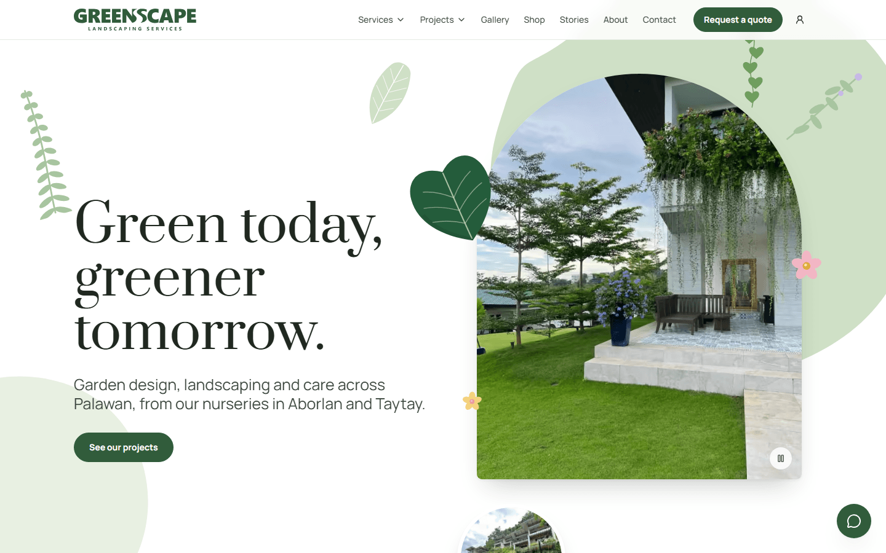 | 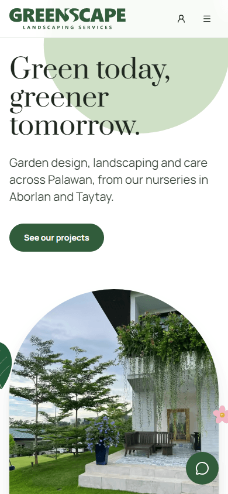 |

Full page: [home-fullpage.png](../assets/screenshots/customer/home/home-fullpage.png) · tablet:
[home-tablet.png](../assets/screenshots/customer/home/home-tablet.png) · Full HD:
[home-fullhd.png](../assets/screenshots/customer/home/home-fullhd.png)

### Layout
1. **Hero**: large serif heading "Green today, greener tomorrow.", a line about garden design across Palawan from the
   Aborlan and Taytay nurseries, a **See our projects** button, and a photo carousel in an arched frame with a pause
   button; botanical illustrations around it.
2. **Four ways we look after a garden**: four service cards (Garden Design, Landscaping, Garden Maintenance, Garden
   Essentials) with a photo, one-line description, a count and a link; **All services**.
3. **Gardens we have built**: featured projects as large alternating photo-and-text cards with category badge,
   place, completion date, photo count; **All projects**.
4. **From our sites**: a masonry wall of site photographs; **Full gallery**.
5. **Stories from the team**: three latest stories; **All stories**.
6. **What clients say**: two testimonials with star ratings; **More feedback**.
7. **Tell us about your garden**: call to action band with **Request a quote**.
8. Footer.

On phones every grid becomes one column and the header menu becomes a sheet.

### Features
| Feature | Behaviour | Data | Status |
|---|---|---|---|
| Hero carousel | Cycles site photos; pause button; stills with reduced motion | CMS home page | Implemented and verified |
| Scroll reveals and parallax | CSS scroll-driven; above-the-fold content is never hidden | — | Implemented and verified (`scroll-animations.spec.ts`) |
| Featured content | Services, projects, photos, stories, testimonials pulled from the CMS | `GET /v1/cms/*`, Redis-cached | Implemented and verified |
| Structured data | `LocalBusiness` JSON-LD | site settings | Implemented |

### States
Content is server-rendered from cache, so there is no loading skeleton. If the CMS is unreachable the
[error page](#404-and-error-pages) is shown.

### Video notes
Scene `full-03` (and `full-01`, `promo-01`, `overview-01`): slow scroll from hero to footer, about 25 s of narration;
highlight the photo wall. See [master storyboard](../video/master-storyboard.md).

---

## About

**URL** `/about` · **Access** public · **Source** `apps/web/app/about/page.tsx` (CMS `about` page)

The company story, team and values, rendered from CMS sections.

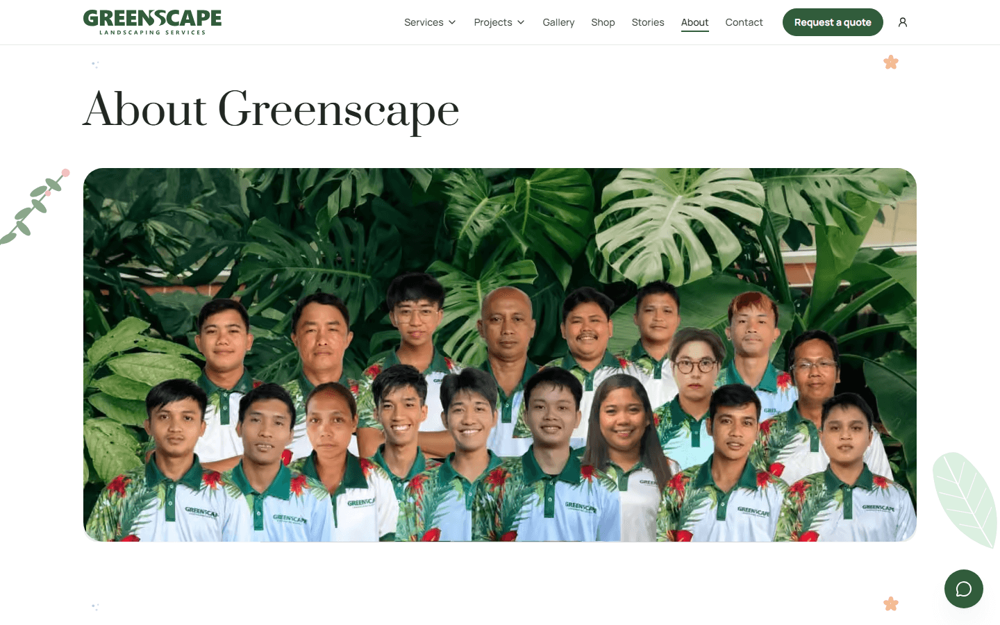

Phone: [about-mobile.png](../assets/screenshots/customer/about/about-mobile.png) · full page:
[about-fullpage.png](../assets/screenshots/customer/about/about-fullpage.png)

Status: implemented and verified.

---

## Stories

**URLs** `/stories`, `/stories/[slug]` · **Access** public · **Source** `apps/web/app/stories/`, `components/cards.tsx`,
`components/youtube.tsx`

News and garden guides written by the team. The list shows story cards (photo, title, date, excerpt); a story page
shows the article with rich text, photos and YouTube embeds (loaded on click), then related stories.

| List | Story |
|---|---|
| 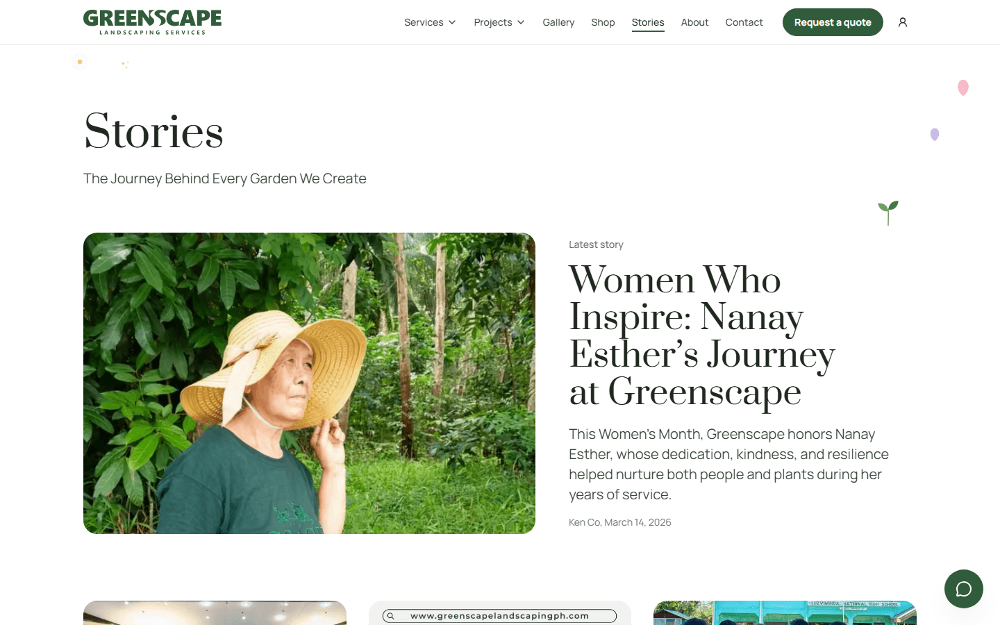 | 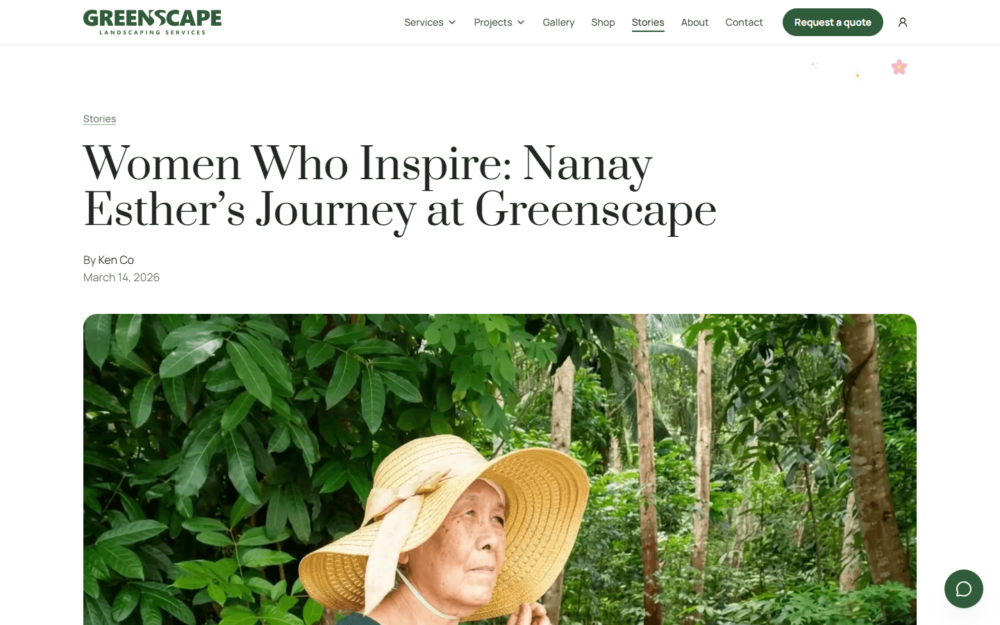 |

Data: `articles` in MongoDB (topics `story` and `garden-essentials`). Old Firestore story URLs redirect (301).
Status: implemented and verified.

---

## Testimonials

**URL** `/testimonials` · **Access** public to read; signed-in to write · **Source** `apps/web/app/testimonials/page.tsx`,
`components/feedback-form.tsx`

Approved client reviews, and a **Worked with us?** form (rating, project optional, text) for signed-in customers.

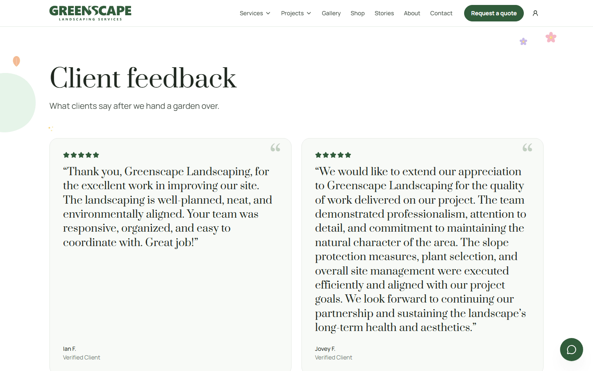

| Feature | Behaviour | API | Permissions |
|---|---|---|---|
| Read reviews | Only reviews staff approved | `GET /v1/testimonials` | public |
| Write a review | Goes to the moderation queue; staff get a notification | `POST /v1/testimonials` | signed in (guest gets 401 → sign-in prompt) |

Moderation: [admin CMS → Testimonials](../admin/cms.md#testimonials). Status: implemented and verified.

---

## FAQ

**URL** `/faq` · **Access** public · **Source** `apps/web/app/faq/page.tsx`

Questions and answers grouped by topic in accordions, rich-text answers. Managed at
[admin CMS → FAQs](../admin/cms.md).

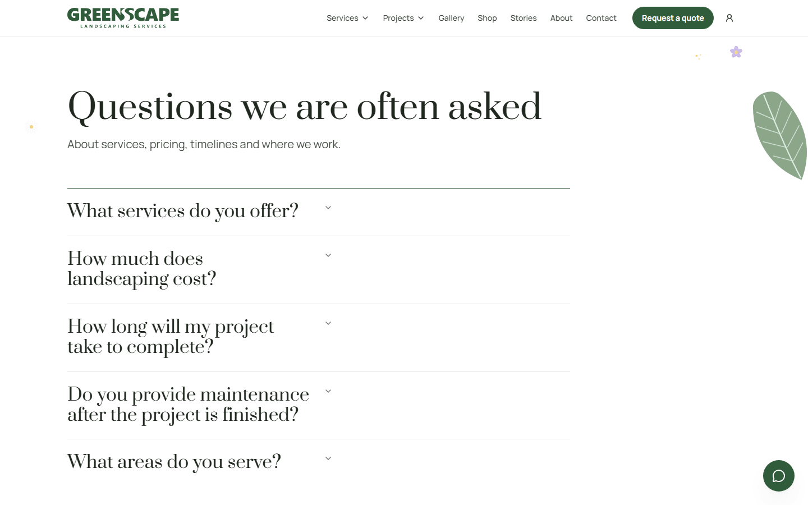

Status: implemented and verified.

---

## Contact

**URL** `/contact` · **Access** public to read; signed-in to send · **Source** `apps/web/app/contact/page.tsx`,
`components/contact-form.tsx`, `contact-details.tsx`

Company address, phone, email and opening details (**Find us**), and a **Send a message** form: full name, email,
phone (optional), subject (optional), message.

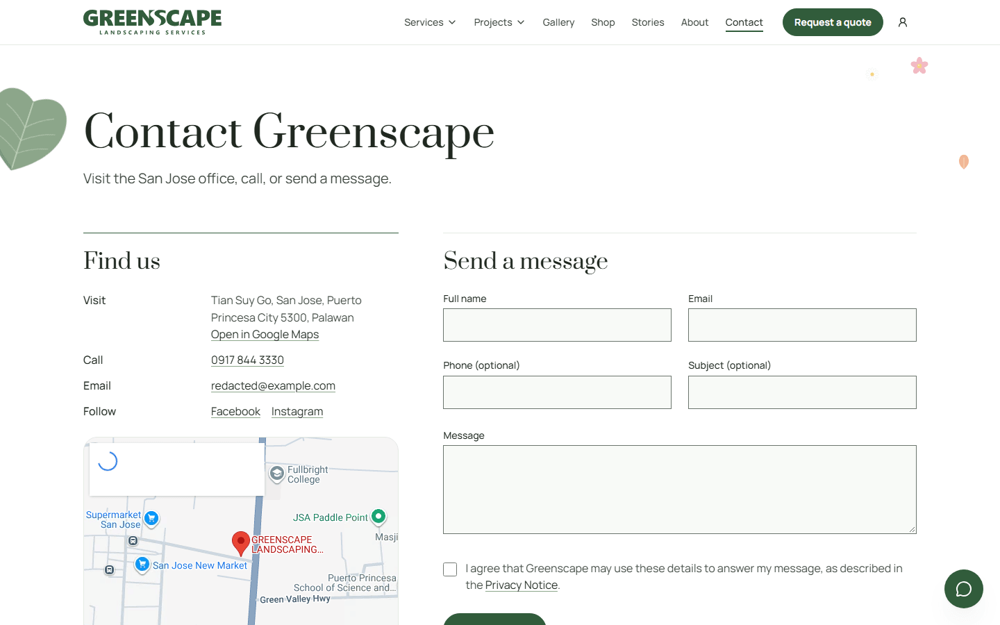

### Workflow
1. Visitor fills in the form. A guest pressing send is asked to sign in; the typed message is kept and restored after
   sign-in (`?intent=contact`).
2. `POST /v1/contact` stores a `ContactInquiry`; staff are emailed and notified.
3. Staff reply from [Messages → Contact form](../admin/commerce.md#messages) by email; the inquiry appears under
   *Messages from the contact form* in the customer's [account](account.md).

### States
Validation errors under each field; per-IP rate limit and honeypot field against spam; a success message after
sending.

Status: implemented and verified.

---

## Quotation request

**URL** `/quote` · **Access** public to start; signed-in to send · **Source** `apps/web/app/quote/page.tsx`,
`components/quote-form.tsx`

A three-step form for landscaping projects.

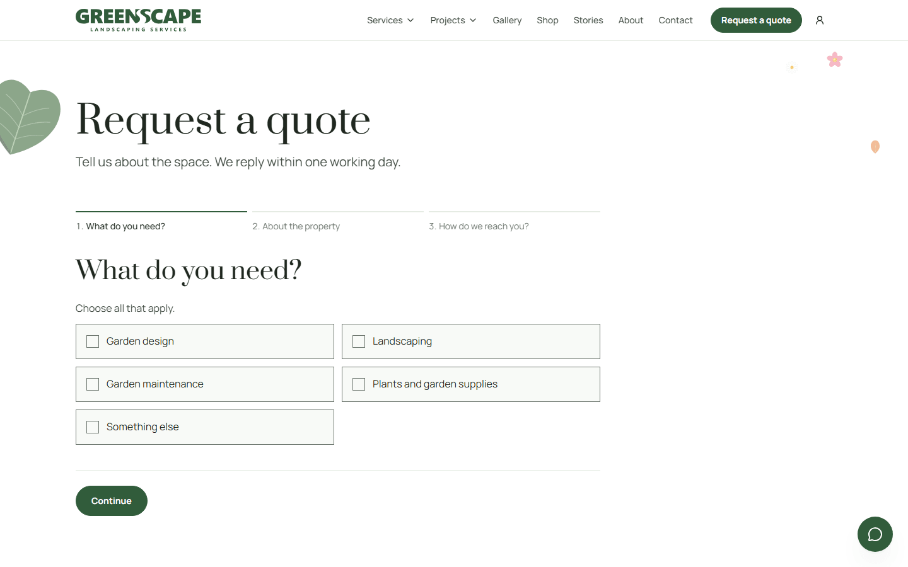

| Step | Fields |
|---|---|
| 1 What do you need? | One or more services (choice cards) |
| 2 About the property | Property type, location, approximate area (optional), budget (optional), preferred start date (optional), your request, photos and plans |
| 3 How do we reach you? | Full name, email, mobile or phone, best time to call (optional), privacy consent |

### Workflow
1. A guest is asked to sign in before step 2, before attaching files and on send; the draft is restored afterwards.
2. Attachments upload to private Supabase Storage through API-issued signed URLs; type and size are checked.
3. `POST /v1/quotations` returns a numbered reference; the customer and staff receive emails.
4. Staff work the request in [admin Quotations](../admin/commerce.md#quotations); the customer sees its status in
   [My account](account.md).

Status: implemented and verified (`public-site.spec.ts`). Video: scene `full-06`.

---

## Delivery policy and privacy

**URLs** `/delivery-policy`, `/privacy` · **Access** public · **Source** `apps/web/app/delivery-policy/`, `privacy/`

Plain text pages: delivery areas, fees and timing; the privacy notice (Philippine Data Privacy Act).

| Delivery policy | Privacy |
|---|---|
| 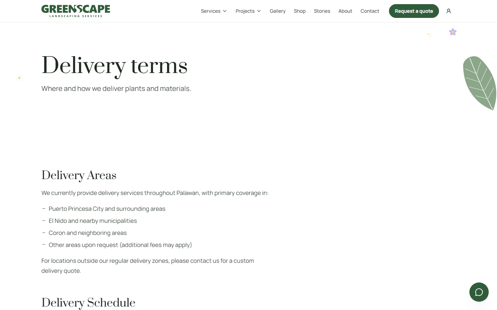 | 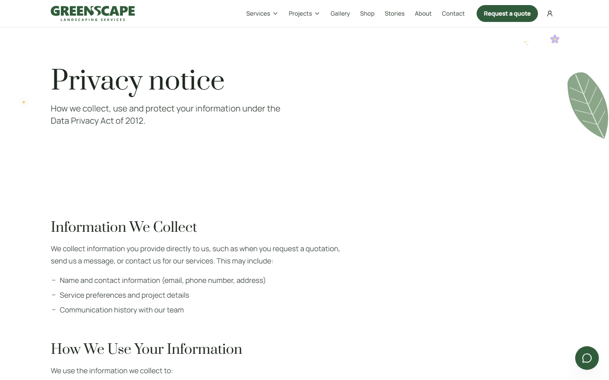 |

---

## CMS pages

**URL** `/[slug]` · **Access** public · **Source** `apps/web/app/[slug]/page.tsx`

Any page staff create in [admin CMS → Pages](../admin/cms.md) with its own slug is served here from its sections.
Unknown slugs return the 404 page. No sample page was captured because the seed has none outside the fixed routes.

---

## Design system gallery

**URL** `/design` · **Access** public (internal reference, not linked from the menu) · **Source** `apps/web/app/design/page.tsx`

Every shared component in its states: colour, typography, buttons, form fields, figures and photographs, accordion
and tabs, dialogs, toasts and tooltips, loading, empty, error and offline states.

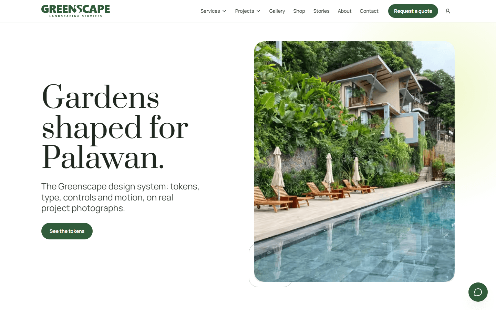

---

## 404 and error pages

**Source** `apps/web/app/not-found.tsx`, `apps/web/app/error.tsx`

The 404 page (title "Page not found", heading "Looks like you’ve wandered off the garden path.") keeps the header and
footer and offers **Back to Home** and **Explore Our Services**; the capture run checks the 404 status code. The
error page catches server failures with **Try again** and the company phone number, and switches to an offline
message when the browser is offline. Both use the botanical illustrations from `packages/ui`.

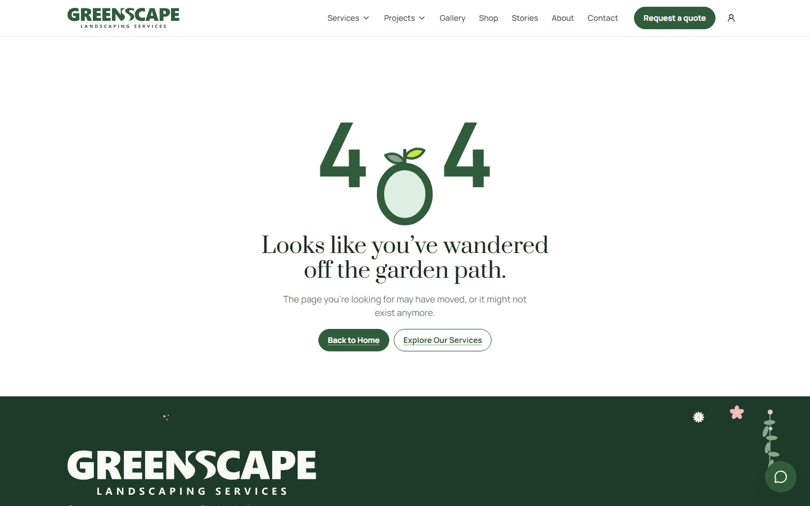

The error page cannot be triggered safely against a running site, so it has no screenshot; its design is shown in the
[design gallery](#design-system-gallery) under *Empty, error and offline states*.
