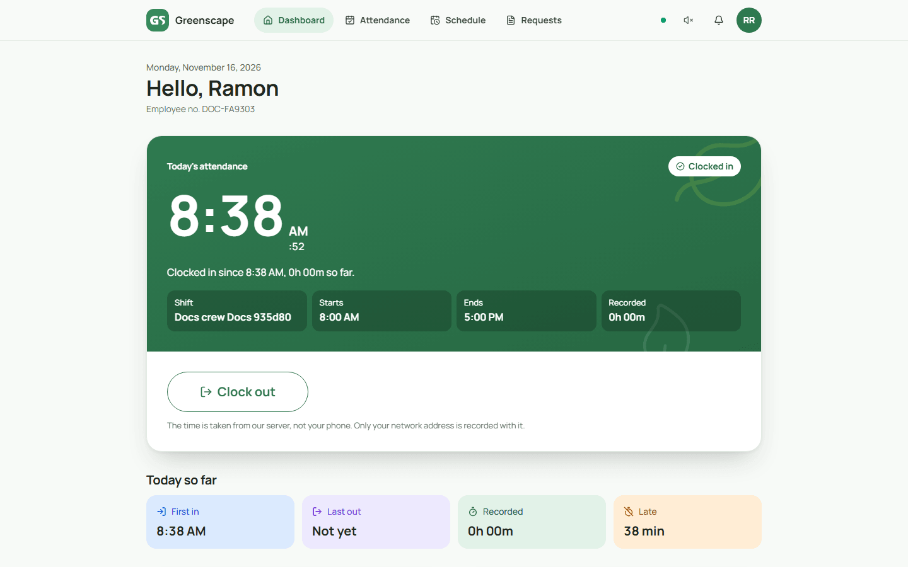

# Employee portal

`apps/employee` · local http://localhost:3002 · production `employee.<domain>`

A phone-first portal for Greenscape's field and nursery staff: clock in and out, see the day's shift and the
schedule, review attendance, and request leave or corrections. It has its own login and session, separate from the
website and the admin console.

| Guide | What |
|---|---|
| [Portal pages](portal.md) | Every page: login, first password, dashboard, attendance, schedule, requests, notifications, profile, 404 |
| [Attendance system](attendance-system.md) | The rules: shifts, grace, late / undertime / overtime, day closing, corrections, leave, selfies |
| [Provisioning](../auth/employee-provisioning.md) | How HR creates logins; temporary passwords |
| [HR side in the admin](../admin/hr.md) | Employees, schedules, attendance board, approvals |

## Who can sign in
Only accounts with the `employee` role **and** a linked HR record, signed in with a password. Customers who try are
told "This portal is for Greenscape employees"; Google sessions get customer permissions only, so they cannot use it.
The old website link `/staff` redirects here.

## What is and isn't there
- **No payroll.** No pay, allowances or government IDs anywhere (decision D5).
- **Offline:** a banner appears and nothing can be saved until the connection returns; nothing is cached for offline
  use.
- **Install as an app:** not on `main` yet; the web app manifest is on an unmerged branch
  ([system status](../overview/system-status.md)). Push notifications work once VAPID keys are configured.

Source: `apps/employee/app/`, `apps/employee/components/`. Tests: `tests/e2e/attendance.spec.ts`,
`tests/e2e/employee/`, `tests/e2e/auth/employee-login.spec.ts`.
