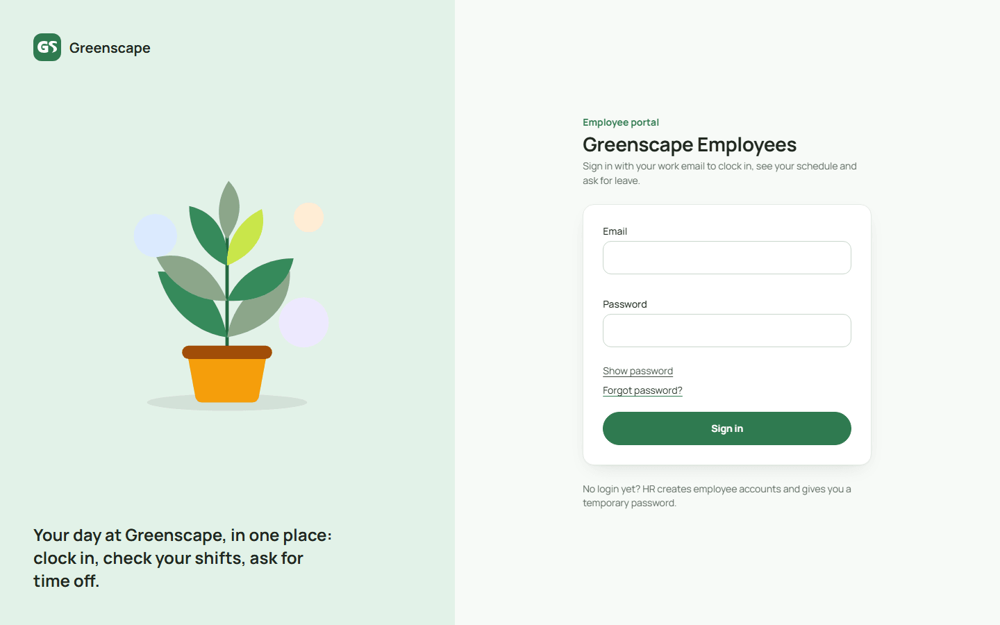
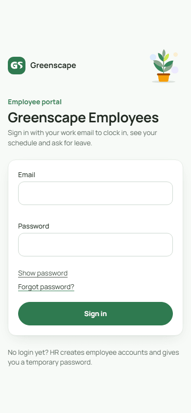
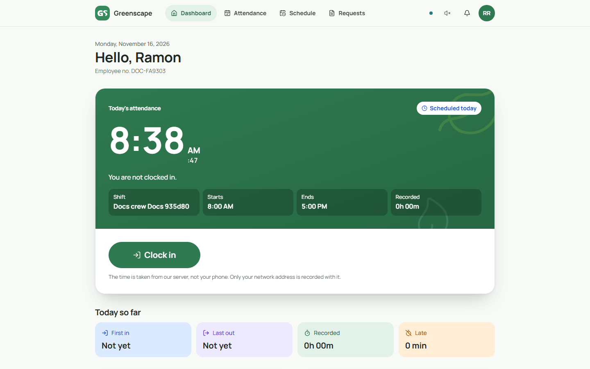
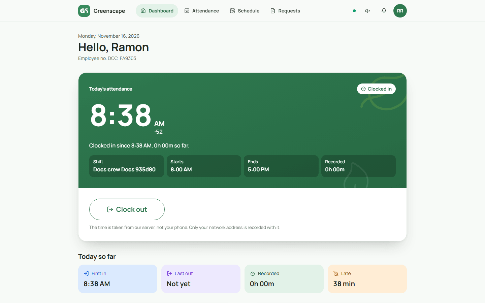
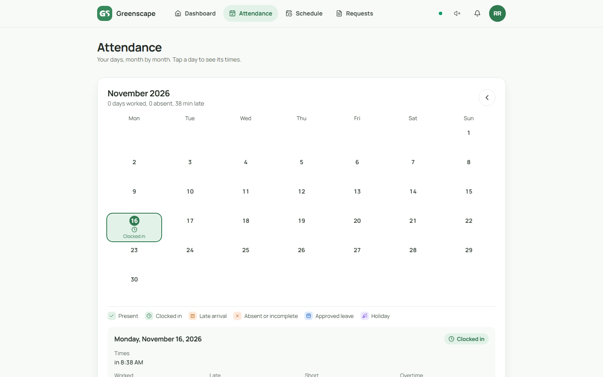
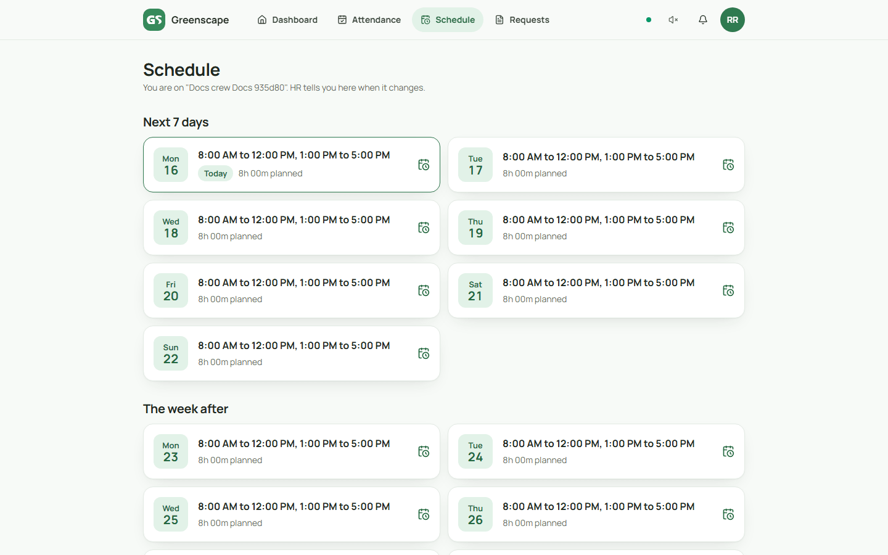
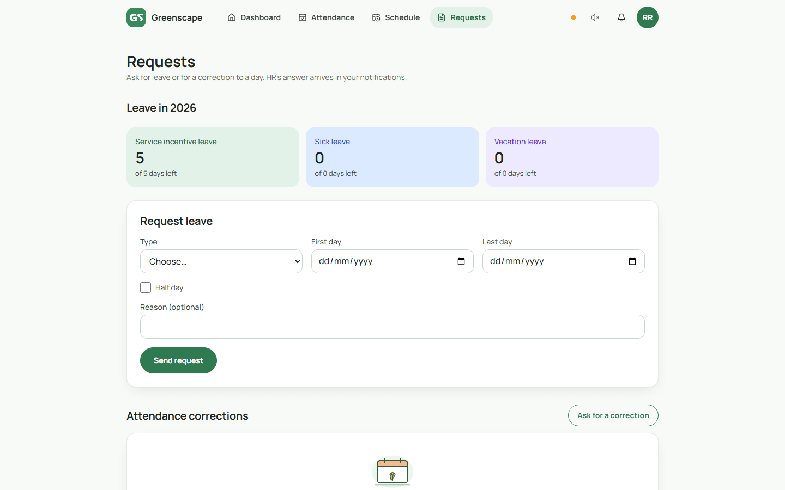
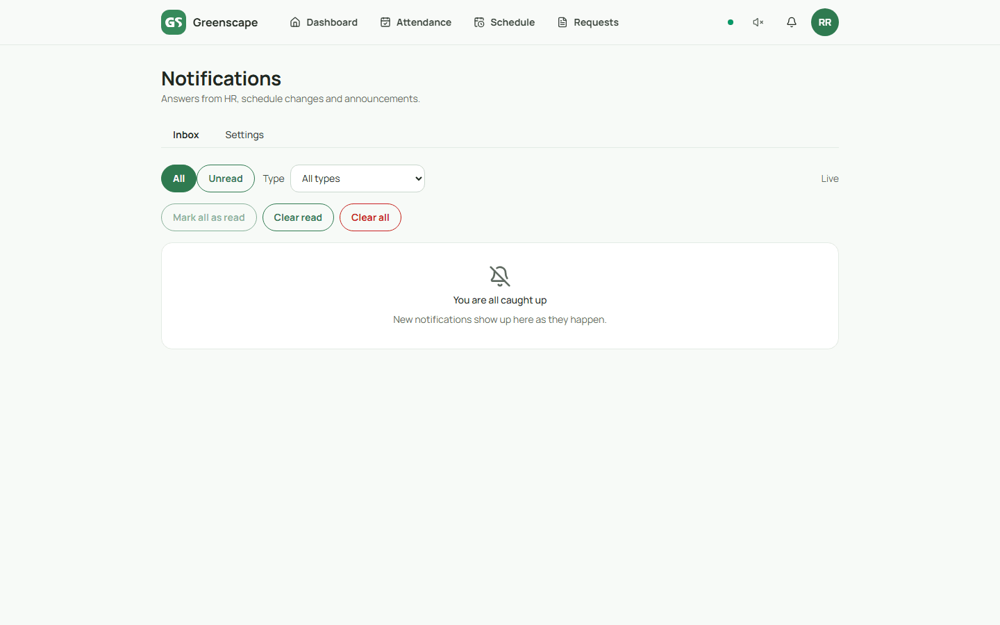
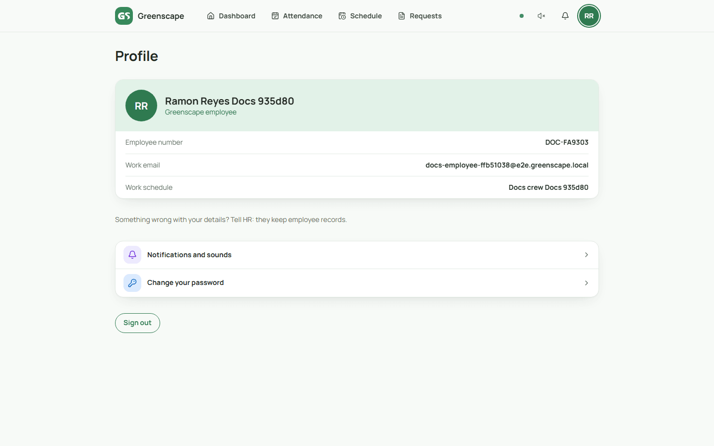
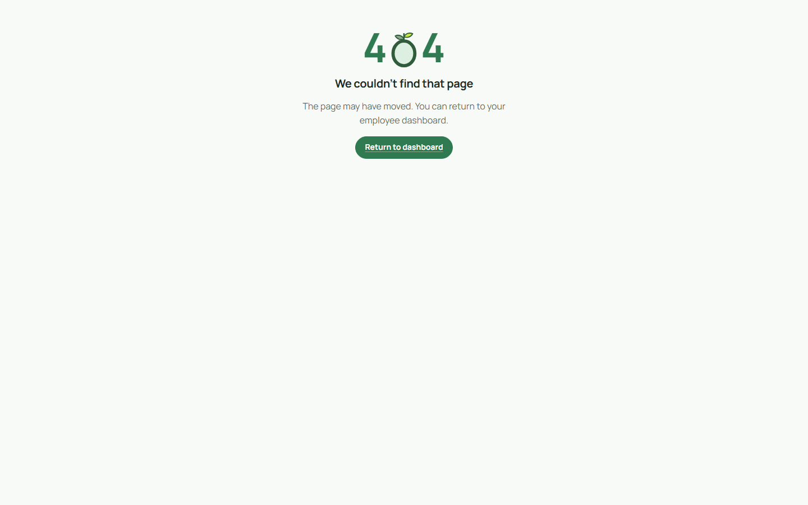

# Employee portal pages

Every page of `apps/employee`, with what it shows and how it behaves. Screenshots were taken as a synthetic employee
("Ramon Reyes") on a split-shift schedule (08:00–12:00 and 13:00–17:00, every day), desktop 1440 × 900 and phone
390 × 844. The portal is designed for phones first; the phone screenshots are the main reference.

Attendance rules (how lateness, undertime and overtime are computed, day closing, corrections and leave):
[attendance-system.md](attendance-system.md). Flow diagram: [attendance workflow](../architecture/diagrams.md#8-employee-attendance).

---

## Sign in

**URL** `/login` · **Access** public · **Source** `apps/employee/app/login/page.tsx`

"Greenscape Employees": email and password only. No registration and no Google button: HR creates every login.

| Desktop | Phone |
|---|---|
|  |  |

Errors: wrong credentials show one generic message; a customer account is told "This portal is for Greenscape
employees". Status: implemented and verified (`tests/e2e/auth/employee-login.spec.ts`).

## Set your password

**URL** `/password` · **Access** an employee who still has a temporary password · **Source** `apps/employee/app/password/page.tsx`

Shown after the first sign-in with the one-time password from HR. Until a new password is chosen the account has
customer permissions only, so no portal page opens. Not captured (needs a fresh temporary password); covered by
`attendance.spec.ts` ("HR adds an employee…").

---

## Dashboard

**URL** `/` · **Access** employee · **Source** `apps/employee/app/(portal)/page.tsx`, `components/clock-card.tsx`,
`components/recent-notifications.tsx`, `components/selfie.tsx`

### Overview
The page an employee opens every morning: a greeting, the clock card, what is coming up and how the week went.

| Before clocking in | After clocking in |
|---|---|
|  |  |

Phone: [before](../assets/screenshots/employee/dashboard/dashboard-before-clock-in-mobile.png) ·
[after](../assets/screenshots/employee/dashboard/dashboard-clocked-in-mobile.png)

### Layout
- **Top bar** (phones: a bottom bar that adds Profile): Dashboard, Attendance, Schedule, Requests; live-connection dot, sound toggle,
  notification bell, account avatar.
- Today's date, **Hello, {first name}**, employee number.
- **Today's attendance** (clock card): the current time, a status pill ("Scheduled today", "Clocked in"…), the status line ("You are not clocked in.", "Clocked in since 2:50 AM, 0h
  00m so far", "Clocked out", "Marked absent", "Correction waiting"), the shift name with **Starts**, **Ends** and
  **Recorded** time (or rest day / flexible / not set), and one large **Clock in** / **Clock out** button. Under it:
  "The time is taken from our server, not your phone. Only your network address is recorded with it."
- **Today so far**: first in, last out, recorded time, minutes late.
- **Coming up** (next shifts), **Last 7 days**, **Recent notifications** with **See all**.

### Features
| Feature | Behaviour | API | Status |
|---|---|---|---|
| Clock in / out | Server time only; repeated or simultaneous taps record one punch; a clock-out less than a minute after clocking in is refused with a message; works as a plain form before JavaScript loads | `POST /v1/me/attendance/punch` | Implemented and verified |
| Clock-in selfie | When HR sets selfies to optional or required: front camera, image shrunk on the phone, uploaded to private storage, deleted after the retention period; no face recognition | `POST /v1/me/attendance/attachments` | Implemented (off by default; the screenshots are with it off) |
| Today's record | Shift and punches, refreshed live | `GET /v1/me/attendance/today` | Implemented and verified |

### Real-time
Clocking in emits an `attendance` live signal: the admin attendance board updates without a reload
([diagram 9](../architecture/diagrams.md#9-socketio-communication)).

### Video notes
Scenes `full-07`, `full-08`, `promo-04`, `overview-04`. Record at phone width; clock out before the take so the
**Clock in** state is shown first.

---

## Attendance

**URL** `/attendance` · **Access** employee (own records only) · **Source** `apps/employee/app/(portal)/attendance/page.tsx`,
`components/month-calendar.tsx`, `components/correction.tsx`

Phone: [attendance-mobile.png](../assets/screenshots/employee/attendance/attendance-mobile.png) · full page:
[attendance-fullpage.png](../assets/screenshots/employee/attendance/attendance-fullpage.png)

- "Your days, month by month. Tap a day to see its times."
- **Month calendar**: the month's totals (days worked, absent, minutes late), each day marked with its status and a
  legend (Present, Clocked in, Late arrival, Absent or incomplete, Approved leave, Holiday); previous month / next
  month. Tapping a day opens its detail: times, worked, late, short and overtime.
- **Last 30 days**: one card per day with status, approval, punches, worked time, minutes late and short.
- **Ask for a correction** on a day that is not approved (or "Missed a whole day?" for a day with no record):
  proposed time in and time out, a reason and an optional photo or PDF, then **Send for approval** ("Sent to your
  manager"). A day with a pending request shows "Correction waiting".

Empty state: "No days recorded yet". API: `GET /v1/me/attendance`, `POST /v1/me/attendance/corrections`.
Status: implemented and verified.

---

## Schedule

**URL** `/schedule` · **Access** employee · **Source** `apps/employee/app/(portal)/schedule/page.tsx`

The assigned work schedule: this week and **the week after**, with shift times and rest days. Holidays and approved
leave are marked. Empty state: "No schedule yet". API: `GET /v1/me/schedule`. HR edits schedules in the
[admin](../admin/hr.md#work-schedules); a change notifies the employee.

---

## Requests

**URL** `/requests` · **Access** employee · **Source** `apps/employee/app/(portal)/requests/page.tsx`,
`components/leave.tsx`, `components/correction.tsx`

Full page: [requests-fullpage.png](../assets/screenshots/employee/requests/requests-fullpage.png)

| Section | What it does |
|---|---|
| Leave in {year} | **Balances** per leave type (service incentive leave seeded at the statutory 5 days; vacation and sick set by HR) |
| Request leave | Leave type, dates, half day option, reason → **Send request**; refused when it exceeds the balance (counting requests still waiting) or overlaps another request; rest days and holidays are not counted |
| Your requests | Status of each request; a waiting one can be withdrawn ("Request withdrawn") |
| Attendance corrections | Corrections waiting for HR ("Waiting for HR"); empty state "No corrections waiting" |

API: `GET/POST /v1/me/leave`, `POST /v1/me/leave/:id/cancel`. Approvals happen in the admin
([leave](../admin/hr.md#leave), [corrections](../admin/hr.md#attendance-board-and-corrections)); the decision arrives
as a notification. Nobody approves their own requests. Status: implemented and verified.

---

## Notifications

**URL** `/notifications` · **Access** employee · **Source** `apps/employee/app/(portal)/notifications/page.tsx`,
`packages/ui/src/notifications/`

Decisions on leave and corrections, schedule changes and reminders about incomplete days. Unread state, mark all as
read, **Clear read** and clear all (with a confirmation). Live over Socket.IO; Web Push to the device when keys are
configured; category, sound and push preferences on the same page.

---

## Profile

**URL** `/profile` · **Access** employee · **Source** `apps/employee/app/(portal)/profile/page.tsx`

Name ("Greenscape employee"), employee number, work email, work schedule ("Not assigned yet" when none), and a note
that HR keeps the records. Links: **Notifications and sounds** (the notifications page, where categories, sound and
push on this device are set), **Change your password** (the password-reset flow on the website), **Sign out**.

---

## Not found and errors

A 404 inside and outside the portal shell, and an error page with **Try again** (`apps/employee/app/(portal)/error.tsx`),
which shows an offline message when the device is offline.

---

## Video notes
| Scene | Page | Action |
|---|---|---|
| `full-07` | `/login`, `/` | Sign in as the demo employee, show the dashboard |
| `full-08` | `/`, `/attendance`, `/schedule` | Clock in, open the calendar, open the schedule |
| `full-09` | `/requests` | File a leave request, show a correction |
| `full-13` | `/` + admin `/attendance` | Clock in while the admin board updates live (two browser profiles) |
