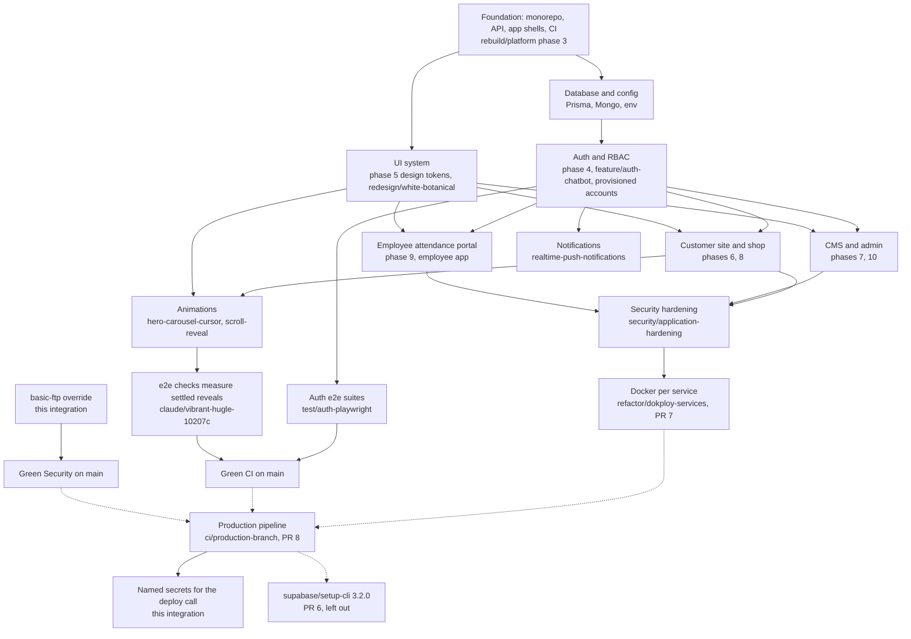

# Dependency graph

Which work depends on which, by what it needs to exist first, not by commit date. Everything above the dashed line
was already in `main` before this integration; it is shown because the two remaining pieces sit on top of it.

## The dependencies that decided the order

| Needs | Before | Why |
| --- | --- | --- |
| `refactor/dokploy-services` (in `main`) | `ci/production-branch` | The pipeline builds `apps/*/Dockerfile`; commit `2bd2172` was written against that layout. |
| `claude/vibrant-hugle-10207c` | `ci/production-branch` | The pipeline's gate requires a green CI run on the same commit. CI could not go green until the three e2e failures were fixed, so PR #8's own `verify` check failed for a reason that was not its own. |
| `basic-ftp` override | `ci/production-branch` being useful | The gate also requires a green Security run. Two advisories published against `basic-ftp` 5.3.1 turned `dependencies` red on `main` (`f3d464f`, `a7829db`). |
| `ci/production-branch` | named-secrets fix | The fix edits files that branch adds. |
| `ci/production-branch` | `supabase/setup-cli` bump | That branch moves the `supabase/setup-cli` line out of `ci.yml` into `.github/actions/local-stack/action.yml`. Bumping first would be undone by the move. |

## What does not depend on anything here

`ci/production-branch` touches no application code, no migration, no lockfile. Nothing in `apps/` or `packages/`
differs between `main` and the integration branch (`git diff --stat origin/main HEAD -- apps packages docker` is
empty).
